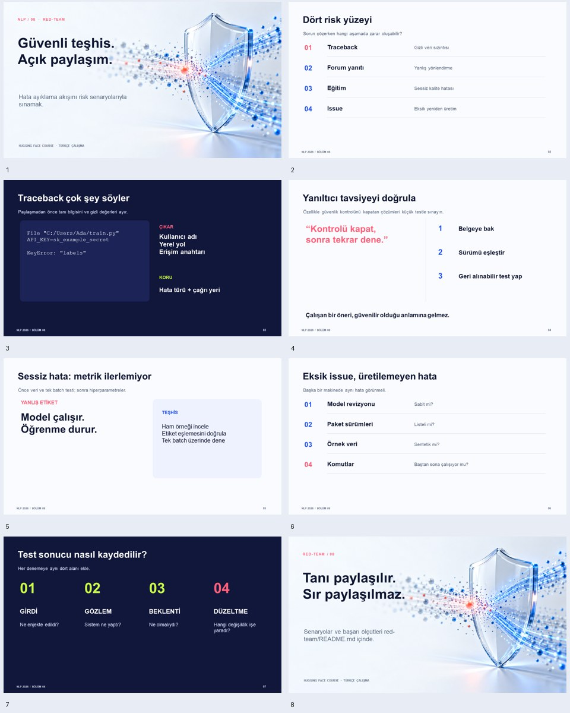

# Hugging Face NLP Kursu Bölüm 8 (Yardım İsteme ve Hata Ayıklama)
## Zafiyet ve Kalite Analizi (Statik Güvenlik ve Kod Denetimi)

> **Proje Kapsamı:** NLP 2026 Güz Dönemi — Bölüm 08 Red-Team Güvenlik ve Kalite Değerlendirmesi  
> **İlgili Sunum:** [2026-guz-nlp08-red-team.pptx](2026-guz-nlp08-red-team.pptx)  
> **Önizleme:** 

---

### 1. Amaç, Kapsam ve Yöntem

Bu çalışma, kursun 8. bölümünün Türkçe çevirisinin **statik incelemesidir**: belge satır satır okunmuş, kod örnekleri ve anlatım güvenlik, güncellik, iç tutarlılık, çeviri kalitesi ve öğretim kapsamı açısından değerlendirilmiştir. Kod çalıştırılmamış, deney yapılmamıştır. Bu yüzden bulgular “gözlenen” değil, “belgeden çıkarılan” bulgulardır. Deneysel doğrulama için Bölüm 7'deki test planı önerilmiştir.

Bulgular üç düzeyde etiketlenmiştir:
* **Doğrulandı:** Doğrudan metinden kanıtlanabilir.
* **Çıkarım:** Metne dayanır ama genel bilgiyle yorumlanmıştır.
* **Doğrulanmalı:** Sürüme bağlıdır, resmî sürüm notlarından teyit edilmelidir.

---

### 2. Güvenlik Bulguları

| # | Bulgu | Etiket | Açıklama |
| --- | --- | --- | --- |
| G1 | Doğrulanmamış modeli yükleme | Çıkarım | Senaryoda meslektaşın Hub’daki modeli doğrudan pipeline ile yükleniyor. Depoda pytorch_model.bin var. .bin ağırlıkları pickle tabanlıdır ve güvenilmeyen kaynaktan yüklemek, eski sürümlerde ve trust_remote_code=True gibi durumlarda rastgele kod çalıştırma riski taşır. Yeni sürümlerde varsayılan korumalar iyileşmiştir (doğrulanmalı). Bölümde güvenilmeyen model uyarısı ve safetensors önerisi yoktur. |
| G2 | Typosquatting tehdit modeli | Çıkarım | Bölümün hata senaryosu bir yazım hatasından (distillbert) doğuyor. Bu, yazım hatalı depo adını kaydedip kötü amaçlı model yayımlama saldırısıyla aynı sınıfa girer. Metin olayı yalnızca “typo” olarak ele alıyor, güvenlik boyutuna değinmiyor. |
| G3 | Başkasının deposuna doğrulamasız yapılandırma yükleme | Doğrulandı | config.push_to_hub() ile varsayılan distilbert-base-uncased yapılandırması basılıyor. Metin yalnızca “kusursuz değil” uyarısı veriyor. Üretimde bu, sessiz bir model bütünlüğü sorununa yol açabilir (yanlış etiket eşlemesi, farklı hiperparametre vb.). |
| G4 | Forum ve GitHub’a hassas bilgi sızıntısı riski | Çıkarım | Metin “traceback’in tamamını yapıştırın” ve transformers-cli env çıktısını paylaşmayı öğütlüyor. Traceback’ler dosya yolları, kullanıcı ve makine bilgisi, bazen token veya anahtar içerebilir. “Paylaşmadan önce hassas bilgileri temizleyin” uyarısı yoktur. |
| G5 | Güncel olmayan kimlik doğrulama anlatımı | Doğrulandı / Doğrulanmalı | “Kullanıcı adınızı ve şifrenizi girmenizi isteyecek” ifadesi güncel uygulamayla (erişim jetonu) uyuşmuyor. Jetonun yerel diskte saklandığı belirtiliyor ama dosya izinleri, jeton kapsamı (yalnızca okuma/yazma) ve sızdırılan jetonun iptali anlatılmıyor. |
| G6 | Kopyala-yapıştır güveni | Çıkarım | Stack Overflow yanıtındaki çözüm, kaynağı veya sürümü sorgulanmadan uygulanıyor. Başkasının kodunu çalıştırmaya dair uyarı yok. |

---

### 3. Teknik Güncellik Bulguları (Doğrulanmalı)

Aşağıdaki maddeler yazarın bilgisine dayanıyor. Sunumdan önce kullanılan sürümün sürüm notlarıyla teyit edilmelidir.

| Belgedeki kullanım | Olası sorun |
| --- | --- |
| evaluation_strategy="epoch" | Yeni sürümlerde eval_strategy adına geçilmiş, eski ad kaldırılmış olabilir. |
| Trainer(..., tokenizer=tokenizer) | Yeni sürümlerde processing_class ile değişmiş olabilir. |
| huggingface_hub.Repository | Kullanımdan kaldırılmış olabilir. |
| from distutils.dir_util import copy_tree | distutils, Python 3.12'de standart kütüphaneden çıkarıldı (kesin). |
| huggingface-cli, transformers-cli env | Komut adları veya davranışları değişmiş olabilir. |
| TensorFlow bölümü | transformers içinde TF desteği azaltılmış olabilir. |

---

### 4. Kod ve İçerik Tutarsızlıkları (Doğrulandı)

* **`text` ve `context` karışıklığı:** İlk hata çıktısında `tokenizer(question, text, ...)` yazıyor, kodda `context` kullanılıyor.
* **`return_tensors` olmadan indeksleme:** `input_ids = inputs["input_ids"][0]` satırı, liste çıktısı verilen durumda anlatılan hatadan bağımsız bir mantık hatası taşıyor.
* **TF’de `label` ve `labels` uyuşmazlığı:** `to_tf_dataset(columns=["input_ids", "labels"])` yazılmış, çıktıda anahtar `label`, sonrasında `batch["labels"]` kullanılıyor. Bu, anlatılan asıl hatayı (etiketin girdi sözlüğünde kalması) bulandırıyor.
* **Kullanılmayan `validation_dataset`:** TF örneğinde oluşturulup `fit` içinde kullanılmıyor. Ayrıca `shuffle=True` ile oluşturulması doğrulama için uygun değil.
* **Bayatlamış şaka ve tarih:** “Kasım 2021'den sonra…” ve belirli bir geliştiriciyi hedef alan “öfke dolu tweetler” ifadesi güncel değil. Çeviride çıkarılması önerilir.

---

### 5. Çeviri ve Belge Kalitesi (Doğrulandı)

* **Anlam bozuklukları:** “metnin metnini okumadan” ifadesinin doğrusu “gövde metnini okumadan” olmalı.
* **Terim tutarsızlığı:** `commit` için “taahhüt”, `branch` için “şube” kullanılmış (yaygın karşılıklar “commit” ve “dal”). “Antrenman” ile “eğitim”, “geri izleme” ile “traceback” karışık kullanılıyor.
* **Gereksiz çeviri:** Görsel alt metinlerinde marka adı çevrilmiş (“Sarılan Yüz forumları”).
* **Belirsiz bağlantı etiketi:** `[bölüm 2](/course/chapter8/section2)` bağlantısı Bölüm 8'in 2. kısmına gidiyor, ancak etiket kursun 2. bölümü gibi okunuyor. “Bölüm 8, 2. kısım” yazılmalı.

---

### 6. Öğretim Kapsamı Boşlukları (Çıkarım)

1. Sessiz hatalar için veri sızıntısı, tekrarlanabilirlik (seed) ve karma hassasiyet/NaN kaynakları anlatılmıyor.
2. Pratik araçlar anılmıyor: `torch.autograd.set_detect_anomaly`, `CUDA_LAUNCH_BLOCKING=1`.
3. Dağıtılmış eğitim tek bir uyarıyla geçiliyor.
4. Güvenlik ve gizlilik konuları (Bölüm 2) tamamen eksik.

---

### 7. Önerilen Deney Planı (Test → Zafiyet → Mekanizma → Beklenti)

> *Not:* Aşağıdaki “beklenti” sütunu belgeden çıkarılmıştır, **henüz çalıştırılıp gözlenmemiştir**.

| Test | Zafiyet | Mekanizma | Beklenti |
| --- | --- | --- | --- |
| 1 | Yanlış etiket sayısı | num_labels=2 modelle 3 sınıflı veri | CPU’da IndexError: Target 2 is out of bounds, GPU’da anlaşılmaz CUDA hatası |
| 2 | Konumsal gömme sınırı | truncation olmadan 512 tokenı aşan metin | IndexError: index out of range in self |
| 3 | Metrik hatası | Logit’in argmax olmadan metriğe verilmesi | TypeError: only size-1 arrays... |
| 4 | Sessiz hata (TF) | "adam" dizesiyle varsayılan öğrenme oranı 1e-3 | Kayıp yüksekte durağanlaşır, 5e-5 ile düşer |
| 5 | Hatalı model kimliği | Hub’da olmayan kimlik | OSError: Can't load config |
| 6 | Hassas veri sızıntısı | Örnek traceback ve ortam çıktıları | Yol, token ve ortam bilgisi grep ile taranabilir |

---

### 8. Öneriler (Öncelik Sırasıyla)

1. **Güvenilmeyen model yükleme uyarısı ve `safetensors` notu ekle.**
2. **Paylaşım öncesi hassas bilgi temizleme uyarısı ekle.**
3. **Güncel olmayan API adlarını sürüme göre güncelle ve belgeye sürüm bilgisi yaz.**
4. **Kod tutarsızlıklarını düzelt** (Bölüm 4, madde 1–4).
5. **Terimleri tek sözlüğe bağla ve çeviri hatalarını gider.**
6. **Kapsam boşlukları için kısa bir “ileri düzey hata ayıklama” kutusu ekle.**

---

### 9. Sınırlılıklar

Bu çalışma yalnızca verilen metne dayanır. Kod çalıştırılmamış, sürüm notları incelenmemiştir. Bölüm 3'teki maddeler ve G1/G5 bulguları, kullanılan sürümün resmî belgeleriyle doğrulanmadan kesin olarak sunulmamalıdır.
