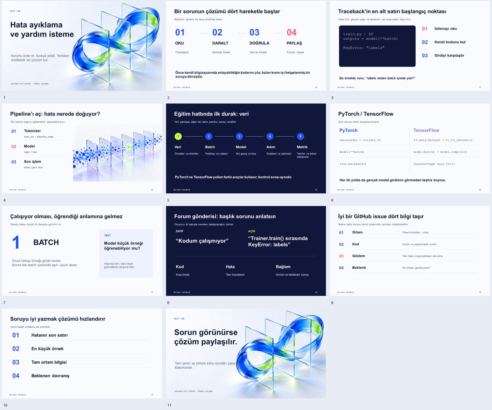

# Bölüm 8 · Sunum Slayt İçerikleri
## NLP 2026 — Hata Ayıklama ve Yardım İsteme

> **Sunum Dosyası:** [2026-guz-nlp08.pptx](2026-guz-nlp08.pptx)  
> **Önizleme Görseli:**   
> **Toplam Slayt Sayısı:** 11  

---

### Slayt 1: Başlık
* **Başlık:** NLP / 08 — Hata ayıklama ve yardım isteme
* **Alt Başlık:** Sorunu izole et. Açıkça anlat. Yeniden üretilebilir bir çözüm bul.
* **Bağlam:** HUGGING FACE COURSE · TÜRKÇE ÇALIŞMA

---

### Slayt 2: Dört Temel Hareket
* **Başlık:** Bir sorunun çözümü dört hareketle başlar
* **Açıklama:** Bölümün tamamı bu akış etrafında ilerler:
  1. **01 OKU:** Traceback (Hata izi)
  2. **02 DARALT:** Minimal yeniden üretilebilir örnek
  3. **03 DOĞRULA:** Veri ve model eşleşmesi
  4. **04 PAYLAŞ:** Topluluk forumu veya GitHub issue bildirimi
* **Özet:** Önce kendi bilgisayarında anlayabildiğin kadarını çöz; kalan kısmı iyi belgelenmiş bir soruya dönüştür.

---

### Slayt 3: Traceback Okuma
* **Başlık:** Traceback’in en alt satırı başlangıç noktası
* **Açıklama:** Hata türü, gerçek çağrı ve beklenen veri arasındaki ilişkiyi kur.
* **Örnek:**
  ```python
  # train.py : 42
  outputs = model(**batch)
  KeyError: "labels"
  ```
* **Adımlar:**
  1. İstisnayı oku
  2. Kendi kodunu bul
  3. Girdiyi karşılaştır (Soru: *"labels neden batch içinde yok?"*)

---

### Slayt 4: Pipeline Aşamaları
* **Başlık:** Pipeline’ı aç: hata nerede doğuyor?
* **Açıklama:** Tek satırlık çağrıyı gözlenebilir aşamalara ayır.
  * **01 Tokenizer:** `input_ids` + `attention_mask` kontrolü
  * **02 Model:** `logits` + `loss` doğrulaması
  * **03 Son İşlem:** Etiket eşleme, yanıt çıkarma, skor hesaplama

---

### Slayt 5: Eğitim Hattında İlk Durak: Veri
* **Başlık:** Veri yanlışsa, diğer her adım yanıltıcı sonuç verebilir.
* **Kontrol Sırası:**
  1. **Veri:** Ham örnekler ve etiketler
  2. **Batch:** Padding ve data collator
  3. **Model:** İleri geçiş (forward pass) ve loss hesabı
  4. **Adım:** Gradient backpropagation ve optimizer
  5. **Metrik:** Tahminler ile gerçek etiketlerin eşleşmesi
* **İlke:** PyTorch ve TensorFlow yolları farklı araçlar kullanır; kontrol sırası aynıdır.

---

### Slayt 6: PyTorch vs TensorFlow
* **Başlık:** Aynı soruyu farklı araçlarla sorarız.
* **Karşılaştırma Tablosu:**
  * **Veri:** PyTorch `DataLoader + collate_fn` ↔ TensorFlow `tf.data.Dataset + to_tf_dataset()`
  * **Model Çağrısı:** PyTorch `model(**batch)` ↔ TensorFlow `model(batch) / model.compile()`
  * **Geriye Yayılım:** PyTorch `loss.backward()` ↔ TensorFlow `tf.GradientTape veya fit()`
* **Kural:** Her iki yolda da gerçek model girdisini görmeden teşhis koyma.

---

### Slayt 7: Sessiz Hatalar
* **Başlık:** Çalışıyor olması, öğrendiği anlamına gelmez.
* **Teşhis:** Sessiz hatayı küçük bir deneyle görünür kıl.
  * **1. Aşama:** Önce birkaç örneği gözle incele.
  * **2. Aşama:** Tek bir batch üzerinde aşırı uyum (overfitting) dene.
* **Test Sorusu:** Model çok küçük bir örneği öğrenebiliyor mu? Hayırsa veri, loss veya ağırlık güncelleme akışına dön.

---

### Slayt 8: Forum Başlığı Yazma
* **Başlık:** Başlık sorunu anlatsın
* **Açıklama:** Okuyucu ilk bakışta nereden başlayacağını bilmeli.
  * ❌ **Zayıf Başlık:** *"Kodum çalışmıyor"*
  * ✅ **Açık Başlık:** *"Trainer.train() sırasında KeyError: labels"*
* **İçerik:** Kısa kod örneği, tam traceback, kütüphane sürümleri ve beklenen sonuç.

---

### Slayt 9: İyi Bir GitHub Issue
* **Başlık:** Bakım ekibi sorunu kendi ortamında yeniden üretebilmelidir.
* **Gerekli Dört Bilgi:**
  1. **Ortam:** Paket sürümleri, işletim sistemi, donanım (CPU/GPU)
  2. **Kod:** Minimal ve kendi kendine yeten çalıştırılabilir örnek
  3. **Gözlem:** Tam hata çıktısı ve gerçekleşen gerçek davranış
  4. **Beklenti:** Olması gereken beklenen davranış

---

### Slayt 10: Soruyu Sıralı Yazmak
* **Başlık:** İçerik kadar sıralama da önemlidir.
* **Akış:**
  1. Hatanın son satırı (Özet)
  2. En küçük yeniden üretilebilir örnek (Minimal repro)
  3. Tam ortam bilgisi (`transformers-cli env`)
  4. Beklenen davranış ve yapılan denemeler

---

### Slayt 11: Kapanış
* **Başlık:** NLP / 08 — Sorun görünürse çözüm paylaşılır.
* **Kapanış Notu:** Tam çeviri ve bölüm sonu soruları çalışma klasöründe mevcuttur.
* **Kaynak:** HUGGING FACE COURSE · TÜRKÇE ÇALIŞMA
