# Bölüm 12: Akıl Yürüten Modeller İnşa Etmek

> **Uyarı:** Bu içerik, SCÜ Şarkışla UBYO Doğal Dil İşleme dersi kapsamında tamamen eğitim amaçlı çevrilmiş ve derlenmiştir. Orijinal dokümantasyon kaynakları (Hugging Face LLM Course, Transformers, Datasets, Tokenizers kütüphaneleri) kendi orijinal lisanslarına (Apache 2.0, MIT, CC-BY 4.0) tabidir. Bu çalışmanın hiçbir ticari amacı yoktur.

---

# Bölüm 12

# Öğrenciler için Open R1

Pekiştirmeli öğrenme (reinforcement learning) ile açık kaynaklı yapay zekâ dünyasına doğru heyecan verici bir yolculuğa hoş geldiniz! Bu bölüm, öğrencilerin pekiştirmeli öğrenmeyi ve onun LLM'lerdeki rolünü anlamalarına yardımcı olmak için tasarlandı.

Ayrıca gelişmiş yapay zekâyı herkes için erişilebilir hâle getiren çığır açıcı bir topluluk projesi olan [Open R1](https://github.com/huggingface/open-r1)'i de inceleyeceğiz. Daha açık söylemek gerekirse, bu kurs öğrencilerin ve öğrenenlerin [Open R1](https://github.com/huggingface/open-r1)'i kullanmalarına ve projeye katkıda bulunmalarına yardımcı olmayı amaçlıyor.

## Neler Öğreneceksiniz

Bu bölümde karmaşık kavramları kolay anlaşılır parçalara ayıracağız ve LLM'lerin karmaşık problemler üzerinde akıl yürütmesini (reasoning) sağlamaya çalışan bu heyecan verici projenin nasıl bir parçası olabileceğinizi göstereceğiz.

LLM'ler birçok üretken (generative) görevde mükemmel performans gösterdi. Ancak yakın zamana kadar akıl yürütme gerektiren karmaşık problemlerde zorlandılar. Örneğin, birden fazla akıl yürütme adımı gerektiren bulmacalar veya matematik problemleriyle başa çıkmakta zorlanıyorlar.

Open R1, LLM'lerin karmaşık problemler üzerinde akıl yürütmesini amaçlayan bir projedir. Bunu, LLM'leri "düşünmeye" ve akıl yürütmeye teşvik etmek için pekiştirmeli öğrenme kullanarak yapar.

Basitçe söylemek gerekirse, model hem düşünceler hem de çıktılar üretecek şekilde eğitilir ve bu düşünceleri ve çıktıları, kullanıcı tarafından ayrı ayrı ele alınabilecek şekilde yapılandırır.

Bir örneğe bakalım. Kendimize aşağıdaki problemi çözme görevini verseydik, şöyle düşünebilirdik:

```sh
Problem: "I have 3 apples and 2 oranges. How many pieces of fruit do I have in total?"

Thought: "I need to add the number of apples and oranges to get the total number of pieces of fruit."

Answer: "5"
```

> Problem: "3 elmam ve 2 portakalım var. Toplamda kaç meyvem var?"
> Düşünce: "Toplam meyve sayısını bulmak için elma ve portakal sayılarını toplamam gerekiyor."
> Cevap: "5"

Daha sonra bu düşünceyi ve cevabı, kullanıcının ayrı ayrı ele alabileceği şekilde yapılandırabiliriz. Akıl yürütme görevleri için LLM'ler, düşünceleri ve cevapları aşağıdaki formatta üretecek şekilde eğitilebilir:

```sh
<think>I need to add the number of apples and oranges to get the total number of pieces of fruit.</think>
5
```

Kullanıcı olarak, modelin çıktısından düşünceyi ve cevabı ayıklayıp problemi çözmek için kullanabiliriz.

## Bu Neden Öğrenciler İçin Önemli

Bir öğrenci olarak Open R1'i ve pekiştirmeli öğrenmenin LLM'lerdeki rolünü anlamak değerlidir, çünkü:
- Size en son teknoloji yapay zekânın nasıl geliştirildiğini gösterir
- Size uygulamalı öğrenme ve katkıda bulunma fırsatları verir
- Yapay zekâ teknolojisinin nereye gittiğini anlamanıza yardımcı olur
- Yapay zekâ alanında gelecekteki kariyer fırsatlarına kapı açar

## Bölüme Genel Bakış

Bu bölüm, her biri Open R1'in farklı bir yönüne odaklanan dört kısma ayrılmıştır:

### 1️⃣ Pekiştirmeli Öğrenmeye ve LLM'lerdeki Rolüne Giriş
Pekiştirmeli Öğrenmenin (RL) temellerini ve LLM'lerin eğitimindeki rolünü inceleyeceğiz.
- RL nedir?
- RL, LLM'lerde nasıl kullanılır?
- DeepSeek R1 nedir?
- DeepSeek R1'in temel yenilikleri nelerdir?

### 2️⃣ DeepSeek R1 Makalesini Anlamak
[Open R1](https://huggingface.co/open-r1)'e ilham veren araştırma makalesini parçalarına ayıracağız:
- Temel yenilikler ve atılımlar
- Eğitim süreci ve mimari
- Sonuçlar ve önemleri

### 3️⃣ GRPO'yu TRL'de Uygulamak
Kod örnekleriyle uygulamaya geçeceğiz:
- Transformer Reinforcement Learning (TRL) kütüphanesi nasıl kullanılır
- GRPO eğitimini kurmak

### 4️⃣ Bir modeli hizalamak (align) için pratik kullanım örneği
Open R1 kullanarak bir modeli hizalamaya yönelik pratik bir kullanım örneğine bakacağız.
- GRPO ile TRL'de bir model nasıl eğitilir
- Modelinizi [Hugging Face Hub](https://huggingface.co/models)'da paylaşın

## Ön Koşullar

Bu bölümden en iyi şekilde yararlanmak için şunlara sahip olmanız faydalı olur:
- Python programlamayı sağlam bir şekilde anlamak
- Makine öğrenmesi kavramlarına aşinalık
- Yapay zekâya ve dil modellerine ilgi

Bunlardan bazıları eksikse endişelenmeyin; ilerledikçe temel kavramları açıklayacağız! 🚀

> 💡 **İpucu:** Ön koşulların hepsine sahip değilseniz, bu [kursun](https://huggingface.co/learn/llm-course/chapter1/1) 1'den 11'e kadar olan ünitelerine göz atın.

## Bu Bölüm Nasıl Kullanılır

1. **Sırayla Okuyun**: Kısımlar birbirinin üzerine inşa edilir, bu yüzden onları sırayla okumak en iyisidir
2. **Notlarınızı Paylaşın**: Temel kavramları ve sorularınızı not edin ve bunları [Discord](https://discord.gg/UrrTSsSyjb)'daki toplulukla tartışın
3. **Kodu Deneyin**: Pratik örneklere geldiğimizde onları kendiniz deneyin
4. **Topluluğa Katılın**: Diğer öğrenenlerle bağlantı kurmak için sağladığımız kaynakları kullanın

Open R1'i keşfetmeye başlayalım ve yapay zekâyı herkes için daha erişilebilir kılmanın nasıl bir parçası olabileceğinizi görelim! 🚀

---

# Pekiştirmeli Öğrenmeye ve LLM'lerdeki Rolüne Giriş

İlk sayfaya hoş geldiniz!

Pekiştirmeli Öğrenmenin (Reinforcement Learning, RL) heyecan verici dünyasında yolculuğumuza başlayacağız ve RL'nin, belki her gün kullandığınız dil modellerini eğitme biçimimizde nasıl devrim yarattığını keşfedeceğiz.

> 💡 **İpucu:** Bu bölümde dil modelleri için pekiştirmeli öğrenmeye odaklanıyoruz. Ancak pekiştirmeli öğrenme, dil modellerinin çok ötesinde birçok uygulaması olan geniş bir alandır. Pekiştirmeli öğrenme hakkında daha fazla bilgi edinmek istiyorsanız [Derin Pekiştirmeli Öğrenme kursuna](https://huggingface.co/courses/deep-rl-course/en/unit1/introduction) göz atmalısınız.

Bu sayfa, daha önce hiç karşılaşmamış olsanız bile, size RL'ye samimi ve net bir giriş sunacak. Temel fikirleri parçalarına ayıracağız ve RL'nin Büyük Dil Modelleri (LLM) alanında neden bu kadar önemli hâle geldiğini göreceğiz.

## Pekiştirmeli Öğrenme (RL) Nedir?

Bir köpeği eğittiğinizi hayal edin. Ona oturmayı öğretmek istiyorsunuz. "Otur!" diyebilirsiniz ve köpek oturursa ona bir ödül maması verir ve onu övebilirsiniz. Oturmazsa, onu nazikçe yönlendirebilir ya da tekrar deneyebilirsiniz. Zamanla köpek, oturmayı olumlu ödülle (mama ve övgü) ilişkilendirmeyi öğrenir ve bir dahaki sefere "Otur!" dediğinizde oturma olasılığı artar. Pekiştirmeli öğrenmede bu geri bildirime **ödül (reward)** diyoruz.

Özetle, Pekiştirmeli Öğrenmenin arkasındaki temel fikir budur! Köpek yerine bir **dil modelimiz** var (pekiştirmeli öğrenmede buna **ajan (agent)** diyoruz) ve sizin yerinize geri bildirim veren **ortam (environment)** var.

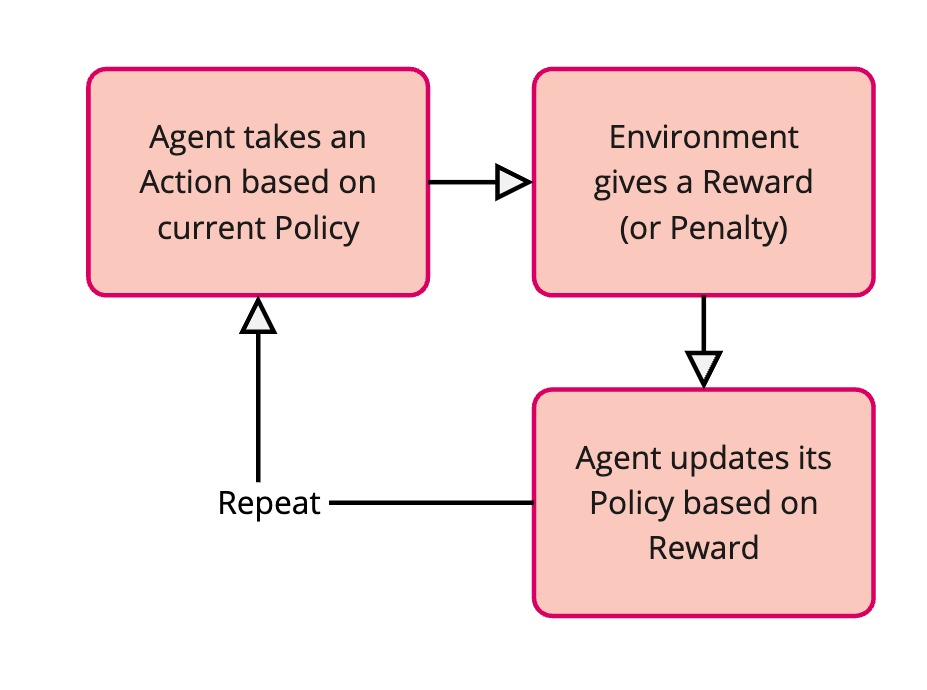

> **Agent takes an Action based on current Policy** = Ajan, mevcut Politikasına göre bir Eylem yapar · **Environment gives a Reward (or Penalty)** = Ortam bir Ödül (veya Ceza) verir · **Agent updates its Policy based on Reward** = Ajan, Ödüle göre Politikasını günceller · **Repeat** = Tekrarla

RL'nin temel parçalarını inceleyelim:

### Ajan (Agent)

Bu bizim öğrenenimizdir. Köpek örneğinde ajan köpektir. LLM'ler bağlamında, eğitmek istediğimiz ajan LLM'nin kendisidir. Ajan, kararları veren ve ortamdan ve ortamın verdiği ödüllerden öğrenen taraftır.

### Ortam (Environment)

Bu, ajanın içinde yaşadığı ve etkileşime girdiği dünyadır. Köpek için ortam sizin eviniz ve sizsiniz. Bir LLM için ortam biraz daha soyuttur: etkileşime girdiği kullanıcılar ya da onun için kurduğumuz simüle edilmiş bir senaryo olabilir. Ortam, ajana geri bildirim sağlar.

### Eylem (Action)

Bunlar, ajanın ortamda yapabileceği seçimlerdir. Köpeğin eylemleri "otur", "kalk", "havla" gibi şeylerdir. Bir LLM için eylemler bir cümlede kelimeler üretmek, bir soruya hangi cevabı vereceğini seçmek ya da bir konuşmada nasıl yanıt vereceğine karar vermek olabilir.

### Ödül (Reward)

Bu, ajan bir eylem yaptıktan sonra ortamın ajana verdiği geri bildirimdir. Ödüller genellikle sayılardır.

**Pozitif ödüller**, mama ve övgü gibidir; ajana "aferin, doğru bir şey yaptın!" derler.

**Negatif ödüller** (veya cezalar) nazik bir "hayır" gibidir; ajana "bu pek doğru olmadı, başka bir şey dene" derler. Köpek için mama ödüldür.

Bir LLM için ödüller, LLM'nin belirli bir görevde ne kadar iyi iş çıkardığını yansıtacak şekilde tasarlanır; belki yanıtının ne kadar yardımcı, doğru (truthful) veya zararsız olduğunu.

### Politika (Policy)

Bu, ajanın eylem seçme stratejisidir. Köpeğin, siz "Otur!" dediğinizde ne yapması gerektiğine dair anlayışı gibidir. RL'de asıl öğrenmeye ve geliştirmeye çalıştığımız şey politikadır. Politika, ajana farklı durumlarda hangi eylemi yapması gerektiğini söyleyen bir kurallar kümesi veya bir fonksiyondur. Başlangıçta politika rastgele olabilir, ancak ajan öğrendikçe politika daha yüksek ödüllere yol açan eylemleri seçmekte daha iyi hâle gelir.

## RL Süreci: Deneme ve Yanılma

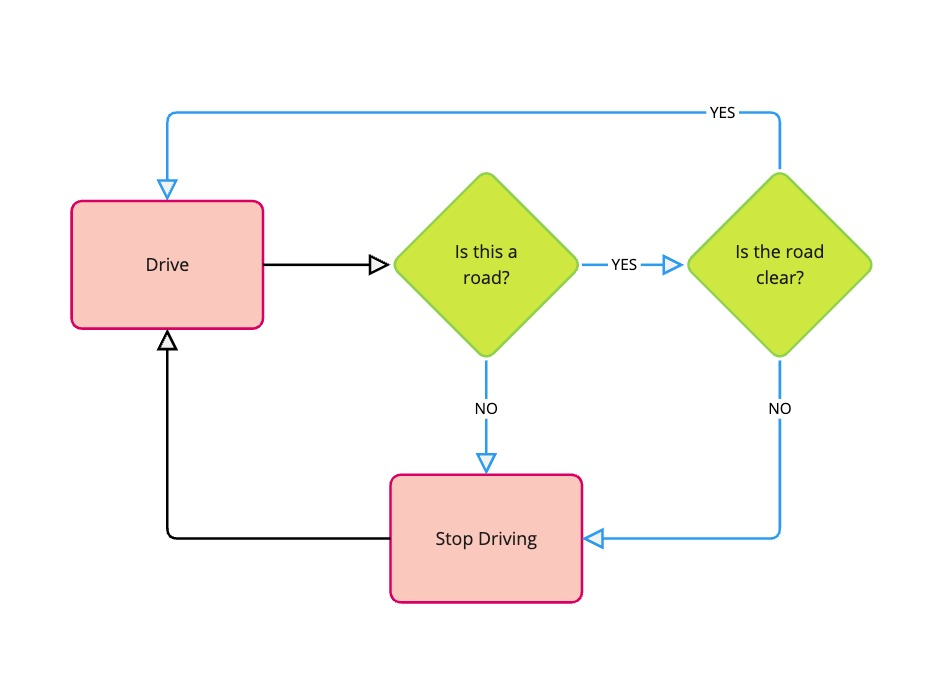

> **Drive** = Sür · **Is this a road?** = Bu bir yol mu? · **Is the road clear?** = Yol açık mı? · **YES** = EVET · **NO** = HAYIR · **Stop Driving** = Sürmeyi durdur

Pekiştirmeli Öğrenme bir deneme-yanılma süreciyle gerçekleşir:

| Adım | Süreç | Açıklama |
|------|-------|----------|
| 1. Gözlem | Ajan ortamı gözlemler | Ajan, mevcut durumu ve çevresi hakkında bilgi alır |
| 2. Eylem | Ajan mevcut politikasına göre bir eylem yapar | Öğrendiği stratejiyi (politikayı) kullanarak ajan bir sonraki adımda ne yapacağına karar verir |
| 3. Geri bildirim | Ortam ajana bir ödül verir | Ajan, eyleminin ne kadar iyi veya kötü olduğuna dair geri bildirim alır |
| 4. Öğrenme | Ajan politikasını ödüle göre günceller | Ajan stratejisini ayarlar: yüksek ödüllere yol açan eylemleri pekiştirir, düşük ödüllere yol açanlardan kaçınır |
| 5. Yineleme | Süreci tekrarla | Bu döngü devam eder ve ajanın karar verme yeteneğini sürekli geliştirmesini sağlar |

Bisiklet sürmeyi öğrendiğinizi düşünün. Başta sallanıp düşebilirsiniz (negatif ödül!). Ama dengede durup rahatça pedal çevirmeyi başardığınızda kendinizi iyi hissedersiniz (pozitif ödül!). Bu geri bildirime göre eylemlerinizi ayarlarsınız (hafifçe eğilmek, daha hızlı pedal çevirmek vb.) ta ki iyi sürmeyi öğrenene kadar. RL de benzerdir: etkileşim ve geri bildirim yoluyla öğrenmekle ilgilidir.

## Pekiştirmeli Öğrenmenin Büyük Dil Modellerindeki (LLM) Rolü

Peki, RL Büyük Dil Modelleri için neden bu kadar önemli?

Gerçekten iyi LLM'ler eğitmek zordur. Onları internetten alınan devasa miktarda metin üzerinde eğitebiliriz ve bir cümledeki bir sonraki kelimeyi tahmin etmekte çok iyi hâle gelirler. [Bölüm 2](https://huggingface.co/learn/llm-course/chapter2/1)'de öğrendiğimiz gibi, akıcı ve dil bilgisi açısından doğru metin üretmeyi bu şekilde öğrenirler.

Ancak sadece akıcı olmak yeterli değildir. LLM'lerimizin kelimeleri art arda dizmekte iyi olmaktan fazlasını yapmasını isteriz. Şunları olmalarını isteriz:

* **Yardımcı (Helpful):** Faydalı ve ilgili bilgi sağlamak.
* **Zararsız (Harmless):** Toksik, önyargılı veya zararlı içerik üretmekten kaçınmak.
* **İnsan Tercihleriyle Hizalı (Aligned with Human Preferences):** İnsanların doğal, yardımcı ve ilgi çekici bulduğu şekillerde yanıt vermek.

Çoğunlukla metin verisinden bir sonraki kelimeyi tahmin etmeye dayanan LLM ön-eğitim (pre-training) yöntemleri bu konularda bazen yetersiz kalır.

Denetimli eğitim (supervised training) yapılandırılmış çıktılar üretmekte mükemmel olsa da, yardımcı, zararsız ve hizalı yanıtlar üretmekte daha az etkili olabilir. Denetimli eğitimi [Bölüm 11](https://huggingface.co/learn/llm-course/chapter11/1)'de inceliyoruz.

İnce ayar yapılmış (fine-tuned) modeller akıcı ve yapılandırılmış metin üretebilir; ancak bu metin yine de olgusal olarak yanlış, önyargılı olabilir ya da kullanıcının sorusunu gerçekten yardımcı bir şekilde yanıtlamayabilir.

**İşte burada Pekiştirmeli Öğrenme devreye giriyor!** RL bize, bu ön-eğitimli LLM'lere istenen nitelikleri daha iyi kazandırmak için ince ayar yapmanın bir yolunu sunar. Bu, LLM köpeğimize ekstra eğitim vermek gibidir; böylece sadece akıcı havlamayı bilen bir köpek değil, terbiyeli ve yardımsever bir yol arkadaşı olur!

## İnsan Geri Bildiriminden Pekiştirmeli Öğrenme (RLHF)

Dil modellerini hizalamak için çok popüler bir teknik **İnsan Geri Bildiriminden Pekiştirmeli Öğrenme (Reinforcement Learning from Human Feedback, RLHF)**'dir. RLHF'de, RL'deki "ödül" sinyalinin yerine geçen bir vekil (proxy) olarak insan geri bildirimini kullanırız. İşleyişi şöyledir:

1. **İnsan Tercihlerini Toplamak:** İnsanlardan, aynı girdi istemi (prompt) için LLM'nin ürettiği farklı yanıtları karşılaştırmalarını ve hangisini tercih ettiklerini söylemelerini isteyebiliriz. Örneğin, bir insana "Fransa'nın başkenti neresidir?" sorusuna verilmiş iki farklı cevap gösterip "Hangi cevap daha iyi?" diye sorabiliriz.

2. **Bir Ödül Modeli Eğitmek:** Bu insan tercih verisini, **ödül modeli (reward model)** adı verilen ayrı bir modeli eğitmek için kullanırız. Bu ödül modeli, insanların ne tür yanıtları tercih edeceğini tahmin etmeyi öğrenir. Yanıtları yardımcı olma, zararsızlık ve insan tercihleriyle hizalanma açısından puanlamayı öğrenir.

3. **LLM'ye RL ile İnce Ayar Yapmak:** Şimdi ödül modelini, LLM ajanımız için ortam olarak kullanırız. LLM yanıtlar üretir (eylemler) ve ödül modeli bu yanıtları puanlar (ödüller sağlar). Özünde, LLM'yi, (insan tercihlerinden öğrenmiş olan) ödül modelimizin iyi bulduğu metni üretecek şekilde eğitiyoruz.

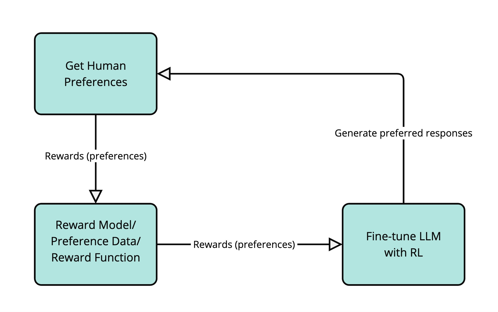

> **Get Human Preferences** = İnsan tercihlerini topla · **Rewards (preferences)** = Ödüller (tercihler) · **Reward Model / Preference Data / Reward Function** = Ödül modeli / Tercih verisi / Ödül fonksiyonu · **Fine-tune LLM with RL** = LLM'ye RL ile ince ayar yap · **Generate preferred responses** = Tercih edilen yanıtları üret

Genel bir perspektiften, LLM'lerde RL kullanmanın faydalarına bakalım:

| Fayda | Açıklama |
|-------|----------|
| Daha İyi Kontrol | RL, LLM'lerin ürettiği metin türü üzerinde daha fazla kontrole sahip olmamızı sağlar. Onları yardımcı, yaratıcı veya öz olmak gibi belirli hedeflerle daha uyumlu metin üretmeye yönlendirebiliriz. |
| İnsan Değerleriyle Daha Güçlü Hizalanma | Özellikle RLHF, LLM'leri karmaşık ve çoğu zaman öznel insan tercihleriyle hizalamamıza yardımcı olur. "İyi bir cevabı ne iyi yapar" için kurallar yazmak zordur, ancak insanlar yanıtları kolayca değerlendirip karşılaştırabilir. RLHF, modelin bu insan yargılarından öğrenmesini sağlar. |
| İstenmeyen Davranışları Azaltmak | RL, LLM'lerdeki toksik dil üretmek, yanlış bilgi yaymak veya önyargı sergilemek gibi olumsuz davranışları azaltmak için kullanılabilir. Bu davranışları cezalandıran ödüller tasarlayarak modeli bunlardan kaçınmaya yönlendirebiliriz. |

İnsan Geri Bildiriminden Pekiştirmeli Öğrenme, bugün en popüler LLM'lerin birçoğunu eğitmek için kullanılmıştır; örneğin OpenAI'ın GPT-4'ü, Google'ın Gemini'si ve DeepSeek'in R1'i. RLHF için farklı karmaşıklık ve gelişmişlik derecelerine sahip çok çeşitli teknikler vardır. Bu bölümde, yardımcı, zararsız ve insan tercihleriyle hizalı LLM'ler eğitmede etkili olduğu gösterilmiş bir RLHF tekniği olan Grup Göreli Politika Optimizasyonuna (Group Relative Policy Optimization, GRPO) odaklanacağız.

## GRPO'yu (Grup Göreli Politika Optimizasyonu) neden önemsemeliyiz?

RLHF için birçok teknik vardır, ancak bu kurs GRPO'ya odaklanıyor, çünkü GRPO dil modelleri için pekiştirmeli öğrenmede önemli bir ilerlemeyi temsil ediyor.

RLHF için diğer iki popüler tekniğe kısaca bakalım:

- Yakınsal Politika Optimizasyonu (Proximal Policy Optimization, PPO)
- Doğrudan Tercih Optimizasyonu (Direct Preference Optimization, DPO)

Proximal Policy Optimization (PPO), RLHF için ilk yüksek etkili tekniklerden biriydi. Ayrı bir ödül modelinden gelen ödüle dayanarak politikayı güncellemek için bir politika gradyanı (policy gradient) yöntemi kullanır.

Direct Preference Optimization (DPO) daha sonra, tercih verisini doğrudan kullanarak ayrı bir ödül modeline olan ihtiyacı ortadan kaldıran daha basit bir teknik olarak geliştirildi. Özünde problemi, seçilen (chosen) ve reddedilen (rejected) yanıtlar arasında bir sınıflandırma görevi olarak ele alır.

> 💡 **İpucu:** DPO ve PPO kendi başlarına karmaşık pekiştirmeli öğrenme algoritmalarıdır ve bu kursta bunları ele almayacağız. Onlar hakkında daha fazla bilgi edinmek istiyorsanız şu kaynaklara göz atabilirsiniz:
>
> - [Proximal Policy Optimization](https://huggingface.co/docs/trl/main/en/ppo_trainer)
> - [Direct Preference Optimization](https://huggingface.co/docs/trl/main/en/dpo_trainer)

DPO ve PPO'dan farklı olarak GRPO, benzer örnekleri bir araya gruplar ve onları bir grup olarak karşılaştırır. Grup tabanlı yaklaşım, diğer yöntemlere kıyasla daha kararlı gradyanlar ve daha iyi yakınsama özellikleri sağlar.

GRPO, DPO gibi tercih verisi kullanmaz; bunun yerine bir modelden veya fonksiyondan gelen ödül sinyalini kullanarak benzer örneklerden oluşan grupları karşılaştırır.

GRPO, ödül sinyallerini elde etme biçiminde esnektir: (PPO'nun yaptığı gibi) bir ödül modeliyle çalışabilir, ancak buna kesin olarak ihtiyaç duymaz. Bunun nedeni, GRPO'nun yanıtların kalitesini değerlendirebilen herhangi bir fonksiyondan veya modelden gelen ödül sinyallerini kullanabilmesidir.

Örneğin, daha kısa yanıtları ödüllendirmek için bir uzunluk fonksiyonu, çözümün doğruluğunu kontrol etmek için bir matematik çözücü ya da olgusal olarak daha doğru yanıtları ödüllendirmek için bir olgusal doğruluk fonksiyonu kullanabiliriz. Bu esneklik GRPO'yu farklı hizalama görevleri için özellikle çok yönlü kılar.

---

Modül 1'i tamamladığınız için tebrikler! Artık Pekiştirmeli Öğrenmeye ve onun Büyük Dil Modellerinin geleceğini şekillendirmedeki kritik rolüne dair sağlam bir girişe sahipsiniz. RL'nin temel kavramlarını, LLM'ler için neden kullanıldığını anlıyorsunuz ve bu alandaki kilit bir algoritma olan GRPO ile tanıştınız.

Bir sonraki modülde ellerimizi kirleteceğiz ve bu kavramları iş başında görmek için DeepSeek R1 makalesine dalacağız!

## Quiz (Test)

### 1. Pekiştirmeli Öğrenmenin temel bileşenleri nelerdir?

- ✅ **Ajan, Ortam, Eylem, Ödül ve Politika**: Doğru! Bunlar bir pekiştirmeli öğrenme sistemini oluşturan temel bileşenlerdir.
- ❌ **Model, Veri, Kayıp Fonksiyonu ve Optimize Edici**: Bunlar daha çok denetimli öğrenmeyle ilişkilendirilen bileşenlerdir.
- ❌ **Girdi, Çıktı ve Gizli Katmanlar**: Bunlar sinir ağı mimarisinin bileşenleridir, özel olarak RL bileşenleri değildir.

### 2. Dil modellerini eğitmek için RLHF'nin ana avantajı nedir?

- ✅ **Modelleri insan tercihleri ve değerleriyle hizalamaya yardımcı olur**: Doğru! RLHF, modelleri daha yardımcı, zararsız ve hizalı davranışa yönlendirmek için insan geri bildirimini kullanır.
- ❌ **Modellerin daha hızlı metin üretmesini sağlar**: RLHF öncelikli olarak üretim hızını artırmakla ilgili değildir.
- ❌ **Modelin bellek kullanımını azaltır**: RLHF, model verimliliğine veya bellek optimizasyonuna odaklanmaz.

### 3. LLM'ler için RL bağlamında bir "eylem"i ne temsil eder?

- ✅ **Kelimeler üretmek veya bir konuşmada yanıtlar seçmek**: Doğru! LLM'ler için eylemler genellikle metin üretme kararlarını içerir.
- ❌ **Model ağırlıklarını güncellemek**: Bu, eğitim sürecinin bir parçasıdır; RL bağlamında bir eylem değildir.
- ❌ **Girdi token'larını işlemek**: Bu, modelin çalışmasının bir parçasıdır; RL bağlamında bir eylem değildir.

### 4. Dil modellerinin RL ile eğitiminde ödülün rolü nedir?

- ✅ **Modelin yanıtlarının istenen davranışla ne kadar uyumlu olduğu hakkında geri bildirim sağlamak**: Doğru! Ödüller, modeli daha yardımcı, doğru ve uygun yanıtlar üretmeye yönlendirir.
- ❌ **Modelin kelime dağarcığı büyüklüğünü ölçmek**: Ödüller, kelime bilgisini değerlendirmek için kullanılmaz.
- ❌ **Modelin eğitim hızını belirlemek**: Ödüller, eğitim verimliliği hakkında değil, yanıt kalitesi hakkında geri bildirim sağlar.

### 5. LLM'ler için RL bağlamında ödül nedir?

- ✅ **Bir yanıtın kalitesini ölçen sayısal bir puan**: Doğru! Ödüller yanıt kalitesi hakkında geri bildirim sağlar ve modeli istenen davranışa yönlendirir.
- ❌ **Yanıt üreten bir fonksiyon**: Ödüller, üretim sürecinin kendisi değil, yanıt kalitesi hakkında geri bildirimdir.
- ❌ **Yanıtların kalitesini değerlendiren bir model**: Ödüller, bir değerlendirme modeli değil, yanıt kalitesi hakkında geri bildirimdir.

---

# DeepSeek R1 Makalesini Anlamak

Bu bölüm hızlandırılmış bir makale okuma kursudur. Makaleyi basit bir dille baştan sona inceleyeceğiz, ardından temel kavramları ve çıkarımları parçalarına ayıracağız.

DeepSeek R1, dil modeli eğitiminde, özellikle pekiştirmeli öğrenme yoluyla akıl yürütme yetenekleri geliştirme konusunda önemli bir ilerlemeyi temsil eder. Makale, Grup Göreli Politika Optimizasyonu (Group Relative Policy Optimization, GRPO) adlı yeni bir pekiştirmeli öğrenme algoritması tanıtır.

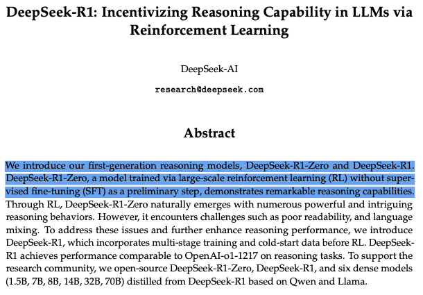

> **DeepSeek-R1: Pekiştirmeli Öğrenme Yoluyla LLM'lerde Akıl Yürütme Yeteneğini Teşvik Etmek** (DeepSeek-AI)
>
> **Özet:** Birinci nesil akıl yürütme modellerimiz DeepSeek-R1-Zero ve DeepSeek-R1'i tanıtıyoruz. Ön adım olarak denetimli ince ayar (SFT) yapılmadan, büyük ölçekli pekiştirmeli öğrenme (RL) ile eğitilmiş bir model olan DeepSeek-R1-Zero, dikkat çekici akıl yürütme yetenekleri sergiler. RL sayesinde DeepSeek-R1-Zero'da doğal olarak çok sayıda güçlü ve ilgi çekici akıl yürütme davranışı ortaya çıkar. Ancak zayıf okunabilirlik ve dil karışımı gibi zorluklarla karşılaşır. Bu sorunları ele almak ve akıl yürütme performansını daha da artırmak için, RL'den önce çok aşamalı eğitim ve soğuk başlangıç verisi içeren DeepSeek-R1'i tanıtıyoruz. DeepSeek-R1, akıl yürütme görevlerinde OpenAI-o1-1217 ile karşılaştırılabilir bir performans elde eder. Araştırma topluluğunu desteklemek için DeepSeek-R1-Zero'yu, DeepSeek-R1'i ve DeepSeek-R1'den Qwen ve Llama tabanlı olarak damıtılmış altı yoğun (dense) modeli (1.5B, 7B, 8B, 14B, 32B, 70B) açık kaynak olarak yayımlıyoruz.

Bir sonraki bölümde bu bilginin üzerine inşa edip GRPO'yu pratikte uygulayacağız.

Makalenin başlangıçtaki amacı, saf pekiştirmeli öğrenmenin, denetimli ince ayar (supervised fine-tuning) olmadan akıl yürütme yetenekleri geliştirip geliştiremeyeceğini araştırmaktı.

> 💡 **İpucu:** O zamana kadar tüm popüler LLM'ler bir miktar denetimli ince ayar gerektiriyordu; bunu [Bölüm 11](https://huggingface.co/learn/llm-course/chapter11/1)'de incelemiştik.

## Çığır Açan "Aha" Anı

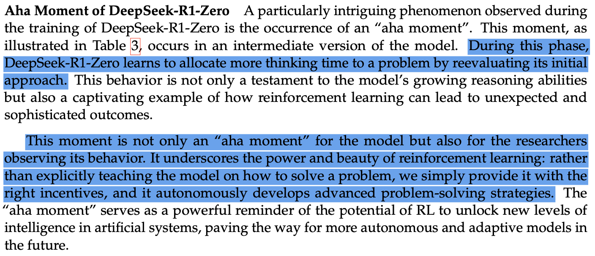

> **DeepSeek-R1-Zero'nun Aha Anı:** DeepSeek-R1-Zero'nun eğitimi sırasında gözlemlenen özellikle ilgi çekici bir olgu, bir "aha anı"nın ortaya çıkmasıdır. Tablo 3'te gösterildiği gibi bu an, modelin ara bir versiyonunda meydana gelir. Bu aşamada DeepSeek-R1-Zero, ilk yaklaşımını yeniden değerlendirerek bir probleme daha fazla düşünme süresi ayırmayı öğrenir. Bu davranış yalnızca modelin gelişen akıl yürütme yeteneklerinin bir kanıtı değil, aynı zamanda pekiştirmeli öğrenmenin beklenmedik ve sofistike sonuçlara nasıl yol açabileceğinin büyüleyici bir örneğidir.
>
> Bu an yalnızca model için değil, onun davranışını gözlemleyen araştırmacılar için de bir "aha anı"dır. Pekiştirmeli öğrenmenin gücünü ve güzelliğini vurgular: modele bir problemi nasıl çözeceğini açıkça öğretmek yerine ona sadece doğru teşvikleri veririz ve o, kendi kendine gelişmiş problem çözme stratejileri geliştirir. "Aha anı", RL'nin yapay sistemlerde yeni zekâ seviyelerinin kilidini açma potansiyelini güçlü biçimde hatırlatır ve gelecekte daha özerk ve uyarlanabilir modellerin önünü açar.

R1-Zero'nun eğitimindeki en dikkat çekici keşiflerden biri, "Aha Anı" (Aha Moment) olarak bilinen bir olgunun ortaya çıkmasıydı. Bu olgu, insanların problem çözerken yaşadığı ani fark edişlere bir ölçüde benzer. İşleyişi şöyledir:

1. İlk Deneme: Model bir problemi çözmek için ilk denemesini yapar
2. Fark Etme: Olası hataları veya tutarsızlıkları fark eder
3. Kendini Düzeltme: Bu fark edişe dayanarak yaklaşımını ayarlar
4. Açıklama: Yeni yaklaşımın neden daha iyi olduğunu açıklayabilir

Bu atılım öğrenenlerde karşılık bulur ve bir "Eureka" anı gibi hissettirir. Salt ezberlemeyi değil öğrenmeyi gösterir; o yüzden bir an durup bir "Aha" anı yaşamanın nasıl bir his olduğunu hayal edelim.

Örneğin, bir yapboz çözmeye çalıştığınızı düşünün:
- İlk deneme: "Bu parça renge göre buraya gelmeli"
- Fark etme: "Ama durun, şekli tam oturmuyor"
- Düzeltme: "Ah, aslında şuraya ait"
- Açıklama: "Çünkü bu konumda hem renk hem de şekil deseni uyuyor"

Bu yetenek, açıkça programlanmadan RL eğitiminden doğal olarak ortaya çıktı; bu da eğitim verisindeki bir sürecin salt ezberlenmesini değil, öğrenmeyi gösterir.

"Aha" anını anlamanın en kolay yolu onu iş başında görmektir. Bir örneğe bakalım. Aşağıdaki sohbette modelden bir problemi çözmesini istiyoruz ve arayüz, model problemi çözerken onun düşünce sürecini gösteriyor.

<https://reasoning-course-deepseek-ai-deepseek-r1-distill-0f5fad4.hf.space/>

DeepSeek'in R1'ini denemek isterseniz [Hugging Chat](https://huggingface.co/chat/models/deepseek-ai/DeepSeek-R1-Distill-Qwen-32B)'e de göz atabilirsiniz.

## Eğitim Süreci

R1'in eğitimi çok aşamalı bir süreçti. Aşamaları ve her aşamadaki temel yenilikleri inceleyelim.

Sürecin sonunda iki model ortaya çıkar:
- DeepSeek-R1-Zero: Tamamen pekiştirmeli öğrenme kullanılarak eğitilmiş bir model.
- DeepSeek-R1: DeepSeek-R1-Zero'nun temeli üzerine inşa edilen ve denetimli ince ayar ekleyen bir model.

| Özellik | DeepSeek-R1-Zero | DeepSeek-R1 |
|---------|------------------|-------------|
| Eğitim Yaklaşımı | Saf RL | Çok aşamalı (SFT + RL) |
| İnce ayar | Yok | Denetimli ince ayar |
| Akıl Yürütme Yeteneği | Kendiliğinden ortaya çıkan (emergent) | Geliştirilmiş |
| AIME Performansı | %71,0 | %79,8 |
| Temel Özellikler | Güçlü akıl yürütme ama okunabilirlik sorunları | Daha iyi dil tutarlılığı ve okunabilirlik |

DeepSeek-R1-Zero, akıl yürütme yetenekleri geliştirmede saf pekiştirmeli öğrenmenin potansiyelini gösterirken, DeepSeek-R1 bu temelin üzerine hem akıl yürütme performansını hem de kullanılabilirliği önceleyen daha dengeli bir yaklaşımla inşa edilir.

Eğitim süreci dört aşamadan oluşur:

1. Soğuk Başlangıç (Cold Start) Aşaması
2. Akıl Yürütme RL (Reasoning RL) Aşaması
3. Ret Örneklemesi (Rejection Sampling) Aşaması
4. Çeşitli RL (Diverse RL) Aşaması

Her aşamayı inceleyelim:

### Soğuk Başlangıç Aşaması (Kalite Temeli)

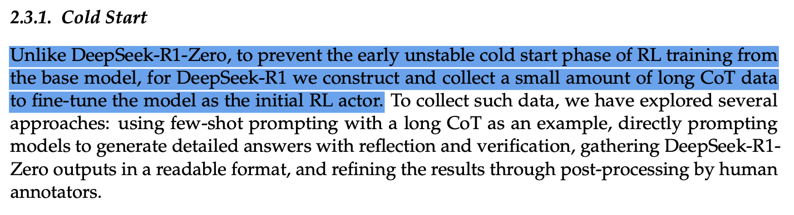

> **2.3.1. Soğuk Başlangıç (Cold Start)**
>
> DeepSeek-R1-Zero'nun aksine, temel modelden başlayan RL eğitiminin erken dönemdeki kararsız soğuk başlangıç aşamasını önlemek için DeepSeek-R1'de, modele ilk RL aktörü olarak ince ayar yapmak üzere az miktarda uzun CoT (düşünce zinciri) verisi oluşturup topluyoruz. Bu tür verileri toplamak için birkaç yaklaşımı araştırdık: örnek olarak uzun bir CoT verilen az örnekli (few-shot) istemler kullanmak, modelleri yansıtma ve doğrulama içeren ayrıntılı cevaplar üretmeye doğrudan yönlendirmek, DeepSeek-R1-Zero çıktılarını okunabilir bir formatta toplamak ve sonuçları insan etiketleyicilerin son işlemesiyle iyileştirmek.

Bu aşama, modelin okunabilirliği ve yanıt kalitesi için güçlü bir temel oluşturmak üzere tasarlanmıştır. V3-Base modeline ince ayar yapmak için R1-Zero'dan alınan yüksek kaliteli örneklerden oluşan küçük bir veri kümesi kullanır. Ekip, DeepSeek-V3-Base modelinden başlayarak, denetimli ince ayar için R1-Zero'dan alınmış, doğrulanmış, yüksek kaliteli binlerce örnek kullandı. Bu yenilikçi yaklaşım, güçlü bir temel okunabilirlik ve yanıt kalitesi oluşturmak için küçük ama yüksek kaliteli bir veri kümesi kullanır.

### Akıl Yürütme RL Aşaması (Yetenek İnşası)

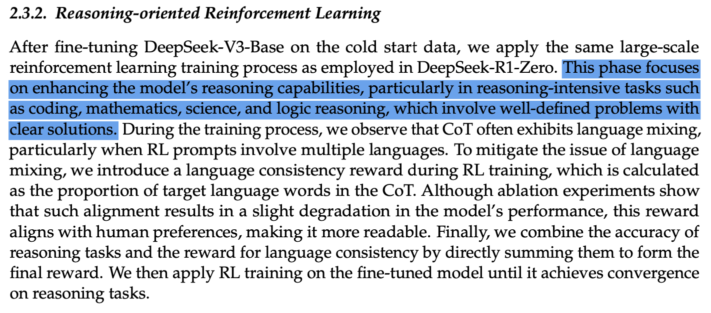

> **2.3.2. Akıl Yürütme Odaklı Pekiştirmeli Öğrenme**
>
> DeepSeek-V3-Base'e soğuk başlangıç verisi üzerinde ince ayar yaptıktan sonra, DeepSeek-R1-Zero'da kullanılanla aynı büyük ölçekli pekiştirmeli öğrenme eğitim sürecini uyguluyoruz. Bu aşama, modelin akıl yürütme yeteneklerini, özellikle iyi tanımlanmış problemler ve net çözümler içeren kodlama, matematik, bilim ve mantıksal akıl yürütme gibi akıl yürütme yoğun görevlerde geliştirmeye odaklanır. Eğitim sürecinde, özellikle RL istemleri birden fazla dil içerdiğinde, CoT'nin sıklıkla dil karışımı sergilediğini gözlemliyoruz. Dil karışımı sorununu hafifletmek için RL eğitimi sırasında, CoT'deki hedef dil kelimelerinin oranı olarak hesaplanan bir dil tutarlılığı ödülü getiriyoruz. Ablasyon deneyleri bu tür bir hizalamanın modelin performansında hafif bir düşüşe yol açtığını gösterse de, bu ödül insan tercihleriyle uyumludur ve çıktıyı daha okunabilir kılar. Son olarak, akıl yürütme görevlerinin doğruluğunu ve dil tutarlılığı ödülünü doğrudan toplayarak nihai ödülü oluşturuyoruz. Ardından ince ayar yapılmış model üzerinde, akıl yürütme görevlerinde yakınsamaya ulaşana kadar RL eğitimi uyguluyoruz.

Akıl Yürütme RL Aşaması; matematik, kodlama, bilim ve mantık dahil alanlarda temel akıl yürütme yeteneklerini geliştirmeye odaklanır. Bu aşama, ödüllerin doğrudan çözümün doğruluğuna bağlı olduğu kural tabanlı pekiştirmeli öğrenme kullanır.

En önemlisi, bu aşamadaki tüm görevler "doğrulanabilir"dir (verifiable); yani modelin cevabının doğru olup olmadığını kontrol edebiliriz. Örneğin matematikte, modelin cevabının doğru olup olmadığını bir matematik çözücü kullanarak kontrol edebiliriz.

Bu aşamayı özellikle yenilikçi kılan, ayrı bir ödül modeline olan ihtiyacı ortadan kaldırarak eğitim sürecini sadeleştiren doğrudan optimizasyon yaklaşımıdır.

### Ret Örneklemesi Aşaması (Kalite Kontrolü)

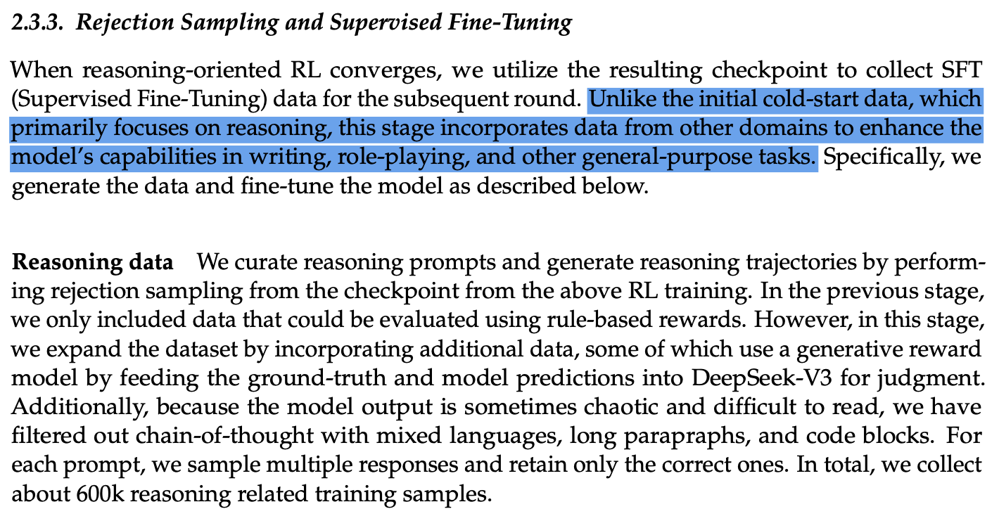

> **2.3.3. Ret Örneklemesi ve Denetimli İnce Ayar**
>
> Akıl yürütme odaklı RL yakınsadığında, ortaya çıkan kontrol noktasını (checkpoint) sonraki tur için SFT (Denetimli İnce Ayar) verisi toplamakta kullanıyoruz. Esas olarak akıl yürütmeye odaklanan ilk soğuk başlangıç verisinin aksine, bu aşama modelin yazma, rol yapma ve diğer genel amaçlı görevlerdeki yeteneklerini geliştirmek için başka alanlardan da veri içerir. Özetle, veriyi aşağıda açıklandığı gibi üretiyor ve modele ince ayar yapıyoruz.
>
> **Akıl yürütme verisi:** Akıl yürütme istemlerini derliyor ve yukarıdaki RL eğitiminden elde edilen kontrol noktasından ret örneklemesi yaparak akıl yürütme izleri üretiyoruz. Önceki aşamada yalnızca kural tabanlı ödüllerle değerlendirilebilen verileri dahil etmiştik. Bu aşamada ise, bazıları gerçek cevabı ve model tahminlerini değerlendirme için DeepSeek-V3'e vererek üretken bir ödül modeli kullanan ek veriler ekleyerek veri kümesini genişletiyoruz. Ayrıca model çıktısı bazen karmaşık ve okunması zor olduğundan, karışık dil, uzun paragraf ve kod bloğu içeren düşünce zincirlerini filtreledik. Her istem için birden fazla yanıt örnekliyor ve yalnızca doğru olanları tutuyoruz. Toplamda akıl yürütmeyle ilgili yaklaşık 600 bin eğitim örneği topluyoruz.

Ret Örneklemesi Aşamasında model örnekler üretir ve bu örnekler daha sonra bir kalite kontrol sürecinden geçirilerek filtrelenir. DeepSeek-V3, salt akıl yürütme görevlerinin ötesine uzanan geniş bir kapsamda çıktıları değerlendiren kalite hakemi olarak görev yapar. Filtrelenen veri daha sonra denetimli ince ayar için kullanılır. Bu aşamanın yeniliği, yüksek standartlı çıktılar sağlamak için birden fazla kalite sinyalini birleştirebilmesinde yatar.

### Çeşitli RL Aşaması (Geniş Hizalama)

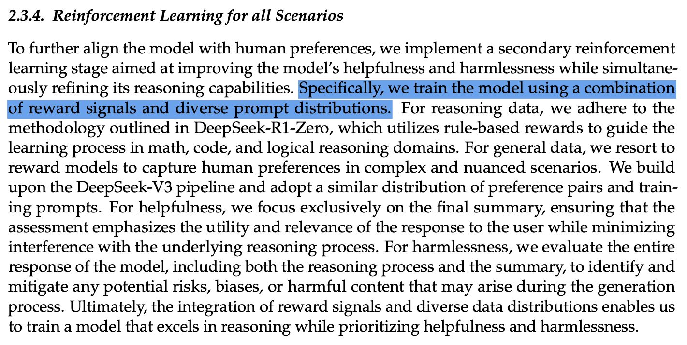

> **2.3.4. Tüm Senaryolar İçin Pekiştirmeli Öğrenme**
>
> Modeli insan tercihleriyle daha da hizalamak için, akıl yürütme yeteneklerini rafine ederken aynı zamanda modelin yardımseverliğini ve zararsızlığını iyileştirmeyi amaçlayan ikinci bir pekiştirmeli öğrenme aşaması uyguluyoruz. Özetle, modeli ödül sinyallerinin ve çeşitli istem dağılımlarının bir birleşimiyle eğitiyoruz. Akıl yürütme verisi için, matematik, kod ve mantıksal akıl yürütme alanlarında öğrenme sürecini yönlendirmek üzere kural tabanlı ödüller kullanan DeepSeek-R1-Zero metodolojisine bağlı kalıyoruz. Genel veri için, karmaşık ve ince ayrımlı senaryolarda insan tercihlerini yakalamak üzere ödül modellerine başvuruyoruz. DeepSeek-V3 hattı üzerine inşa ediyor ve benzer bir tercih çiftleri ve eğitim istemleri dağılımı benimsiyoruz. Yardımseverlik için yalnızca nihai özete odaklanıyoruz; böylece değerlendirme, alttaki akıl yürütme sürecine müdahaleyi en aza indirirken yanıtın kullanıcı için faydasını ve ilgisini öne çıkarıyor. Zararsızlık için ise üretim sürecinde ortaya çıkabilecek olası riskleri, önyargıları veya zararlı içerikleri belirleyip azaltmak amacıyla, akıl yürütme süreci ve özet dahil modelin tüm yanıtını değerlendiriyoruz. Sonuç olarak, ödül sinyallerinin ve çeşitli veri dağılımlarının bir araya getirilmesi, yardımseverliği ve zararsızlığı önceliklendirirken akıl yürütmede üstün olan bir model eğitmemizi sağlar.

Son aşama olan Çeşitli RL Aşaması, gelişmiş bir hibrit yaklaşım kullanarak birden çok görev türünü ele alır. Deterministik görevler için kural tabanlı ödüller kullanırken, öznel görevler LLM geri bildirimiyle değerlendirilir. Bu aşama, kural tabanlı sistemlerin kesinliğini dil modeli değerlendirmesinin esnekliğiyle birleştiren yenilikçi hibrit ödül yaklaşımıyla insan tercihleriyle hizalanmayı amaçlar.

## Algoritma: Grup Göreli Politika Optimizasyonu (GRPO)

Eğitim sürecini iyi anladığımıza göre, modeli eğitmek için kullanılan algoritmaya bakalım.

Yazarlar GRPO'yu model ince ayarında bir atılım olarak tanımlıyor:

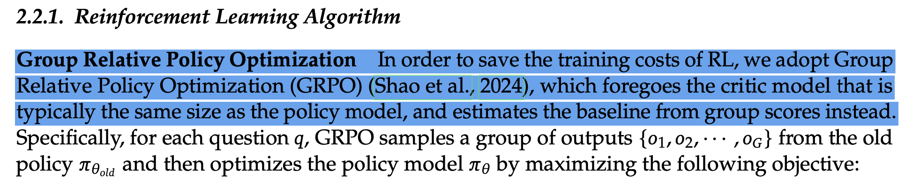

> **2.2.1. Pekiştirmeli Öğrenme Algoritması**
>
> **Grup Göreli Politika Optimizasyonu:** RL'nin eğitim maliyetlerinden tasarruf etmek için, genellikle politika modeliyle aynı boyutta olan eleştirmen (critic) modelinden vazgeçen ve taban çizgisini (baseline) bunun yerine grup puanlarından tahmin eden Grup Göreli Politika Optimizasyonunu (GRPO) (Shao ve ark., 2024) benimsiyoruz. Özetle, her soru $q$ için GRPO, eski politika $\pi_{\theta_{old}}$'dan bir çıktı grubu $\{o_1, o_2, \cdots, o_G\}$ örnekler ve ardından politika modeli $\pi_\theta$'yı aşağıdaki hedefi maksimize ederek optimize eder:

GRPO'nun yeniliği, "tercih düzeltmesi için doğrudan optimizasyon yapabilme" (directly optimize for preference rectification) kapasitesinde yatar. Bu, PPO gibi geleneksel Pekiştirmeli Öğrenme algoritmalarının aksine, modeli istenen çıktılarla hizalamanın daha doğrudan ve verimli bir yolu anlamına gelir. GRPO'nun nasıl çalıştığını üç ana bileşeni üzerinden inceleyelim.

### Grup Oluşturma: Birden Fazla Çözüm Üretmek

GRPO'daki ilk adım son derece sezgiseldir: bir öğrencinin zor bir problemi birden fazla yaklaşım deneyerek çözmesine benzer. Bir istem (prompt) verildiğinde model yalnızca tek bir yanıt üretmez; bunun yerine aynı problemi çözmek için birden fazla deneme oluşturur (genellikle 4, 8 veya 16 farklı deneme).

Bir modele matematik problemleri çözmeyi öğrettiğinizi düşünün. Bir çiftlikteki tavukları saymakla ilgili bir soru için model birkaç farklı çözüm üretebilir:
- Bir çözüm problemi adım adım parçalayabilir: önce toplam tavukları sayar, sonra horozları çıkarır ve son olarak yumurtlamayan tavukları hesaba katar
- Bir diğeri farklı ama aynı derecede geçerli bir yaklaşım kullanabilir
- Bazı denemeler hatalar ya da daha az verimli çözümler içerebilir

Tüm bu denemeler bir grup olarak bir arada tutulur; tıpkı karşılaştırıp ders çıkarmak için birden fazla öğrencinin çözümüne sahip olmak gibi.

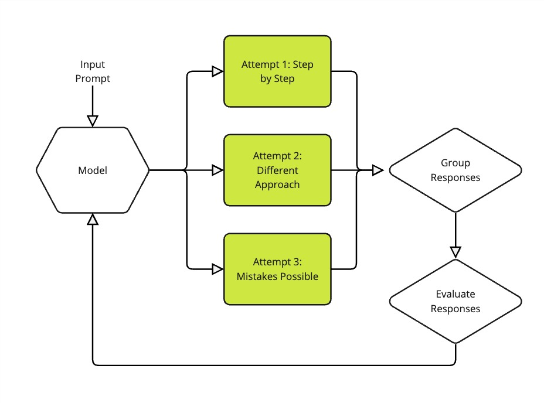

> **Input Prompt** = Girdi istemi · **Model** = Model · **Attempt 1: Step by Step** = Deneme 1: Adım adım · **Attempt 2: Different Approach** = Deneme 2: Farklı yaklaşım · **Attempt 3: Mistakes Possible** = Deneme 3: Hatalar olabilir · **Group Responses** = Yanıtları grupla · **Evaluate Responses** = Yanıtları değerlendir

### Tercih Öğrenme: İyi Bir Çözümü Neyin İyi Yaptığını Anlamak

GRPO'nun sadeliğiyle gerçekten parladığı yer burasıdır. Bir çözümün ne kadar iyi olabileceğini tahmin etmek için her zaman ayrı bir ödül modeline ihtiyaç duyan diğer RLHF yöntemlerinin aksine, GRPO bir çözümün kalitesini değerlendirmek için herhangi bir fonksiyonu veya modeli kullanabilir. Örneğin, daha kısa yanıtları ödüllendirmek için bir uzunluk fonksiyonu ya da doğru matematiksel çözümleri ödüllendirmek için bir matematik çözücü kullanabiliriz.

Değerlendirme süreci her çözümün çeşitli yönlerine bakar:
- Nihai cevap doğru mu?
- Çözüm doğru biçimlendirmeye uydu mu (örneğin doğru XML etiketlerini kullanmak gibi)?
- Akıl yürütme, verilen cevapla tutarlı mı?

Bu yaklaşımı özellikle zekice kılan şey puanlamayı nasıl ele aldığıdır. GRPO sadece mutlak puanlar vermek yerine, ödülleri her grubun içinde normalleştirir. Grup göreli avantaj tahmini (group relative advantage estimation) için basit ama etkili bir formül kullanır:

```
Advantage = (reward - mean(group_rewards)) / std(group_rewards)
```

Yani: **Avantaj = (ödül − grup ödüllerinin ortalaması) / grup ödüllerinin standart sapması**

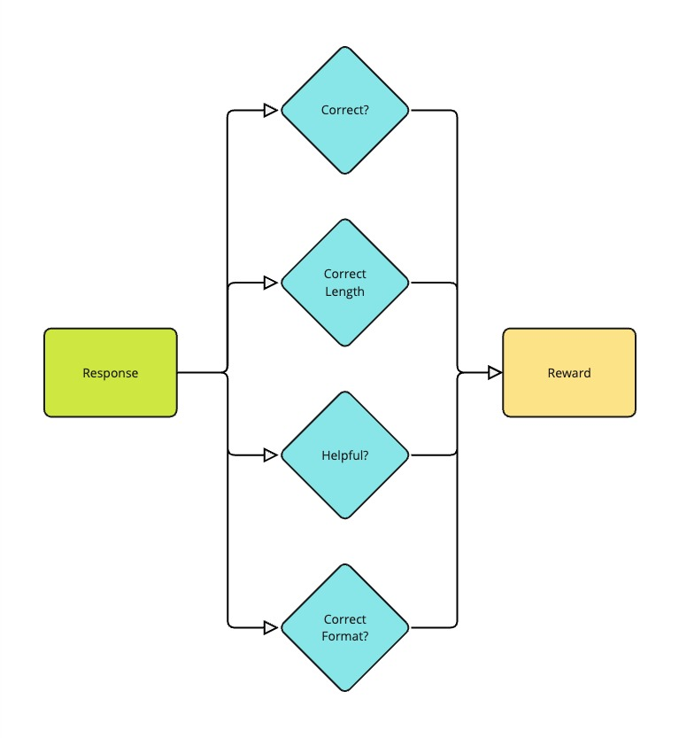

> **Response** = Yanıt · **Correct?** = Doğru mu? · **Correct Length** = Doğru uzunluk · **Helpful?** = Yardımcı mı? · **Correct Format?** = Doğru format mı? · **Reward** = Ödül

Bu normalleştirme, yapay zekâ için "çan eğrisine göre not vermek" gibidir. Modelin, sadece mutlak puanlara bakmak yerine, gruptaki hangi çözümlerin akranlarına kıyasla daha iyi veya daha kötü olduğunu anlamasına yardımcı olur.

### Optimizasyon: Deneyimden Öğrenmek

Son adım, GRPO'nun, çözüm grubunu değerlendirmekten öğrendiklerine dayanarak modeli gelişmeye yönlendirdiği yerdir. Bu süreç hem güçlü hem de kararlıdır ve iki ana prensip kullanır:

1. Modeli başarılı çözümlere benzer daha fazla çözüm üretmeye teşvik ederken daha az etkili yaklaşımlardan uzaklaştırır
2. Modelin bir anda çok sert değişmesini engelleyen bir güvenlik mekanizması (KL ıraksama cezası, KL divergence penalty) içerir

Bu yaklaşım geleneksel yöntemlerden daha kararlıdır, çünkü:
- Aynı anda sadece iki çözümü karşılaştırmak yerine birden fazla çözüme birlikte bakar
- Grup tabanlı normalleştirme, ödül ölçeklemesiyle ilgili sorunları önlemeye yardımcı olur
- KL cezası bir güvenlik ağı gibi davranır ve modelin yeni şeyler öğrenirken zaten bildiklerini unutmamasını sağlar

> 💡 **İpucu:** GRPO'nun temel yenilikleri şunlardır:
> - Herhangi bir fonksiyondan veya modelden doğrudan öğrenebilmek; böylece ayrı bir ödül modeline bağımlılığı ortadan kaldırmak.
> - İkili karşılaştırmalar gibi geleneksel yöntemlerden daha kararlı ve verimli olan grup tabanlı öğrenme.

Bu inceleme karmaşık, ancak akılda tutulması gereken ana nokta şu: GRPO, bir modeli akıl yürütmeye eğitmenin daha verimli ve daha kararlı bir yoludur.

### Sözde Kodla (Pseudocode) GRPO Algoritması

GRPO'nun temel bileşenlerini anladığımıza göre, algoritmaya sözde kod (pseudocode) olarak bakalım. Bu, algoritmanın basitleştirilmiş bir versiyonudur, ancak temel fikirleri yakalar.

```
Input: 
- initial_policy: Starting model to be trained
- reward_function: Function that evaluates outputs
- training_prompts: Set of training examples
- group_size: Number of outputs per prompt (typically 4-16)

Algorithm GRPO:
1. For each training iteration:
   a. Set reference_policy = initial_policy (snapshot current policy)
   b. For each prompt in batch:
      i. Generate group_size different outputs using initial_policy
      ii. Compute rewards for each output using reward_function
      iii. Normalize rewards within group:
           normalized_advantage = (reward - mean(rewards)) / std(rewards)
      iv. Update policy by maximizing the clipped ratio:
          min(prob_ratio * normalized_advantage, 
              clip(prob_ratio, 1-epsilon, 1+epsilon) * normalized_advantage)
          - kl_weight * KL(initial_policy || reference_policy)
          
          where prob_ratio is current_prob / reference_prob

Output: Optimized policy model
```

> **Girdi:**
> - `initial_policy`: Eğitilecek başlangıç modeli
> - `reward_function`: Çıktıları değerlendiren fonksiyon
> - `training_prompts`: Eğitim örnekleri kümesi
> - `group_size`: İstem başına çıktı sayısı (genellikle 4-16)
>
> **GRPO Algoritması:**
> 1. Her eğitim yinelemesi için:
>    a. `reference_policy = initial_policy` yap (mevcut politikanın anlık kopyasını al)
>    b. Yığındaki (batch) her istem için:
>       i. `initial_policy` kullanarak `group_size` kadar farklı çıktı üret
>       ii. `reward_function` ile her çıktı için ödülü hesapla
>       iii. Ödülleri grup içinde normalleştir: `normalized_advantage = (reward - mean(rewards)) / std(rewards)`
>       iv. Kırpılmış (clipped) oranı maksimize ederek politikayı güncelle: `min(prob_ratio * normalized_advantage, clip(prob_ratio, 1-epsilon, 1+epsilon) * normalized_advantage) - kl_weight * KL(initial_policy || reference_policy)`; burada `prob_ratio = current_prob / reference_prob`
>
> **Çıktı:** Optimize edilmiş politika modeli

Bu algoritma, GRPO'nun grup tabanlı avantaj tahminini politika optimizasyonuyla nasıl birleştirdiğini ve kararlılığı kırpma (clipping) ve KL ıraksama kısıtlarıyla nasıl koruduğunu gösterir.

## Sonuçlar ve Etki

Algoritmayı incelediğimize göre sonuçlara bakalım. DeepSeek R1 birçok alanda en ileri düzey (state-of-the-art) performans elde eder:

| Alan | Temel Sonuçlar |
|------|----------------|
| Matematik | • AIME 2024'te %79,8<br>• MATH-500'de %97,3 |
| Kodlama | • Codeforces Puanı: 2029<br>• LiveCodeBench: %65,9 |
| Genel Bilgi | • MMLU: %90,8<br>• GPQA Diamond: %71,5 |
| Dil Görevleri | • AlpacaEval 2.0: %87,6 kazanma oranı<br>• FRAMES: %82,5 |

Modelin pratik etkisi, maliyet açısından verimli API fiyatlandırması (milyon girdi token'ı başına 0,14 $) ve çeşitli boyutlarda (1,5B'den 70B parametreye kadar) başarılı model damıtma (distillation) sayesinde kıyaslama testlerinin (benchmark) ötesine uzanır. Dikkat çekici biçimde, 7B model bile AIME 2024'te %55,5'e ulaşırken, 70B damıtılmış versiyon MATH-500'de (%94,5) o1-mini performansına yaklaşır; bu da farklı ölçeklerde yeteneklerin etkili biçimde korunduğunu gösterir.

## GRPO'nun Sınırlamaları ve Zorlukları

GRPO, dil modelleri için pekiştirmeli öğrenmede önemli bir ilerlemeyi temsil etse de, sınırlamalarını ve zorluklarını anlamak önemlidir:

- **Üretim Maliyeti**: Her istem için birden fazla tamamlama (4-16) üretmek, yalnızca bir veya iki tamamlama üreten yöntemlere kıyasla hesaplama gereksinimlerini artırır.
- **Yığın Boyutu (Batch Size) Kısıtları**: Tamamlama gruplarını birlikte işleme ihtiyacı, etkin yığın boyutlarını sınırlayabilir; bu da eğitim sürecine karmaşıklık ekler ve eğitimi yavaşlatabilir.
- **Ödül Fonksiyonu Tasarımı**: Eğitimin kalitesi büyük ölçüde iyi tasarlanmış ödül fonksiyonlarına bağlıdır. Kötü tasarlanmış ödüller istenmeyen davranışlara veya yanlış hedefler için optimizasyona yol açabilir.
- **Grup Boyutu Ödünleşimleri**: En uygun grup boyutunu seçmek, çözüm çeşitliliği ile hesaplama maliyeti arasında denge kurmayı gerektirir. Çok az örnek yeterli çeşitlilik sağlamayabilir, çok fazlası ise eğitim süresini ve kaynak gereksinimlerini artırır.
- **KL Iraksama Ayarı**: KL ıraksama cezası için doğru dengeyi bulmak dikkatli ayar gerektirir: çok yüksek olursa model etkili biçimde öğrenemez, çok düşük olursa başlangıçtaki yeteneklerinden fazla uzaklaşabilir.

## Sonuç

DeepSeek R1 makalesi, dil modeli geliştirmede önemli bir kilometre taşını temsil eder. Grup Göreli Politika Optimizasyonu (GRPO) algoritması, saf pekiştirmeli öğrenmenin gerçekten de güçlü akıl yürütme yetenekleri geliştirebileceğini göstermiş ve denetimli ince ayarın gerekliliğine dair önceki varsayımlara meydan okumuştur.

Belki de en önemlisi, DeepSeek R1 yüksek performansı maliyet etkinliği ve erişilebilirlik gibi pratik hususlarla dengelemenin mümkün olduğunu göstermiştir. Modelin yeteneklerinin 1,5B'den 70B parametreye kadar farklı boyutlara başarıyla damıtılması, gelişmiş yapay zekâ yeteneklerini daha yaygın olarak erişilebilir kılmak için ileriye dönük bir yol göstermektedir.

---

Bir sonraki kısımda, bu kavramların pratik uygulamalarını inceleyeceğiz ve kendi dil modeli geliştirme projelerinizde GRPO ile RFTrans'tan nasıl yararlanabileceğinize odaklanacağız.

## Quiz (Test)

### 1. DeepSeek R1 makalesinin ana yeniliği nedir?

- ✅ **Ödül modeliyle ve ödül modeli olmadan tercihlerden öğrenmeyi sağlayan GRPO algoritması**: Doğru! GRPO'nun temel yeniliği, tercih düzeltmesi için doğrudan optimizasyon yapabilmesidir; bu da onu geleneksel RL yöntemlerinden daha verimli kılar.
- ❌ **Eğitim için önceki tüm modellerden daha fazla GPU kullanmak**: Makalenin yeniliği kullanılan hesaplama kaynaklarında değil, algoritmik yaklaşımındadır (GRPO).
- ❌ **Mevcut olanlardan daha büyük bir dil modeli oluşturmak**: Yenilik model boyutunda değil, eğitim metodolojisinde ve GRPO algoritmasında yatar.

### 2. DeepSeek R1 eğitim sürecinin dört aşaması nelerdir?

- ✅ **Soğuk Başlangıç, Akıl Yürütme RL, Ret Örneklemesi ve Çeşitli RL**: Doğru! Bunlar makalede tanımlanan dört aşamanın ta kendisidir ve her biri eğitim hattında belirli bir amaca hizmet eder.
- ❌ **Ön-eğitim, İnce ayar, Test ve Dağıtım (Deployment)**: Makale özellikle dört farklı aşama tanımlar: Soğuk Başlangıç (kalite temeli), Akıl Yürütme RL (yetenek inşası), Ret Örneklemesi (kalite kontrolü) ve Çeşitli RL (geniş hizalama).
- ❌ **Veri Toplama, Model Eğitimi, Değerlendirme ve Optimizasyon**: Makale; Soğuk Başlangıç, Akıl Yürütme RL, Ret Örneklemesi ve Çeşitli RL aşamalarını içeren belirli bir dört aşamalı süreç tanımlar.

### 3. R1-Zero'nun eğitimindeki "Aha Anı" olgusu nedir?

- ✅ **Modelin hataları fark ettiği, kendini düzelttiği ve düzeltmelerini açıkladığı bir süreç**: Doğru! Makale bunu dört adımlı bir süreç olarak tanımlar: ilk deneme, hataların fark edilmesi, kendini düzeltme ve iyileştirmenin açıklanması.
- ❌ **Modelin insan düzeyinde performansa ulaştığı nokta**: "Aha Anı", özellikle modelin kendi hatalarını fark edip düzeltme yeteneğini ifade eder; insanların problem çözerken yaşadığı fark edişlere benzer.
- ❌ **Modelin eğitim sürecini tamamladığı an**: "Aha Anı", eğitimin tamamlanmasıyla değil, modelin problem çözerken hataları fark edip kendini düzeltme yeteneğinin kendiliğinden ortaya çıkmasıyla ilgilidir.

### 4. GRPO'nun grup oluşturma adımı nasıl çalışır?

- ✅ **Aynı problem için birden fazla çözüm (4-16) üretir ve onları birlikte değerlendirir**: Doğru! GRPO aynı problemi çözmek için genellikle 4, 8 veya 16 farklı deneme üretir ve bunlar daha sonra bir grup olarak değerlendirilir.
- ❌ **Birden fazla modeli tek bir topluluk (ensemble) hâlinde birleştirir**: GRPO, farklı modellerden oluşan bir topluluk değil, birden fazla çözüm denemesi üreten tek bir model kullanır.
- ❌ **Eğitim verisini farklı gruplara böler**: GRPO'nun grup oluşturması, eğitim verisini bölmeyi değil, aynı problem için birden fazla çözüm üretmeyi içerir.

### 5. DeepSeek-R1-Zero ile DeepSeek-R1 arasındaki temel fark nedir?

- ✅ **R1-Zero saf RL kullanırken R1, RL'yi denetimli ince ayarla birleştirir**: Doğru! Karşılaştırma tablosunda gösterildiği gibi R1-Zero saf RL eğitimi kullanırken, R1 denetimli ince ayarı RL ile birleştiren çok aşamalı bir yaklaşım kullanır ve bu da daha iyi dil tutarlılığı sağlar.
- ❌ **R1-Zero, R1'den daha küçüktür**: Fark model boyutlarında değil, eğitim yaklaşımlarındadır (saf RL'ye karşı çok aşamalı).
- ❌ **R1-Zero daha az veriyle eğitildi**: Temel ayrım eğitim metodolojileridir: R1-Zero için saf RL, R1 için ise SFT ve RL'yi birleştiren yaklaşım.

---

# DeepSeekMath'te Grup Göreli Politika Optimizasyonunu (GRPO) İleri Düzeyde Anlamak

> 💡 **İpucu:** Bu kısım GRPO'nun teknik ve matematiksel ayrıntılarına dalıyor. Yazarı <a href="https://huggingface.com/shirinyamani" target="_blank">Shirin Yamani</a>'dir.

Modelimizin eğitim sürecini iyileştirebilmek için GRPO'yu daha derinlemesine anlayalım.

GRPO, ayrı bir değer modeli (Critic, yani "eleştirmen") eğitmek yerine, politika modelini optimize etmek için model tarafından üretilen yanıtları üretim grupları içinde birbiriyle karşılaştırarak doğrudan değerlendirir. Bu yaklaşım hesaplama maliyetinde önemli bir azalmaya yol açar!

GRPO, yanıtın doğruluğunun belirlenebildiği her doğrulanabilir (verifiable) göreve uygulanabilir. Örneğin matematiksel akıl yürütmede, yanıtın doğruluğu gerçek cevapla (ground truth) karşılaştırılarak kolayca doğrulanabilir.

Teknik ayrıntılara dalmadan önce GRPO'nun üst düzeyde nasıl çalıştığını görselleştirelim:

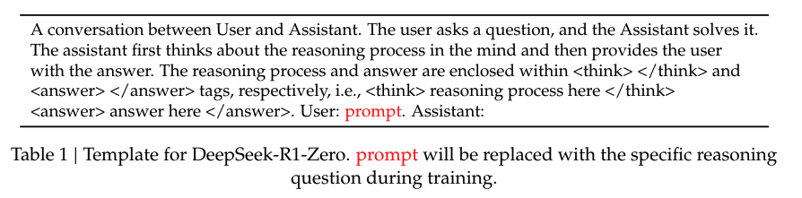

> Kullanıcı ile Asistan arasında bir konuşma. Kullanıcı bir soru sorar ve Asistan onu çözer. Asistan önce zihninde akıl yürütme sürecini düşünür, ardından kullanıcıya cevabı verir. Akıl yürütme süreci ve cevap sırasıyla &lt;think&gt; &lt;/think&gt; ve &lt;answer&gt; &lt;/answer&gt; etiketleri içine alınır, yani &lt;think&gt; akıl yürütme süreci burada &lt;/think&gt; &lt;answer&gt; cevap burada &lt;/answer&gt;. Kullanıcı: **prompt**. Asistan:
>
> **Tablo 1 | DeepSeek-R1-Zero için şablon.** *prompt*, eğitim sırasında belirli akıl yürütme sorusuyla değiştirilecektir.

Görsel bir genel bakışa sahip olduğumuza göre, GRPO'nun nasıl çalıştığını adım adım inceleyelim.

## GRPO Algoritması

GRPO'nun temel yeniliği, aynı anda üretilmiş birden fazla yanıtı değerlendirme ve onlardan öğrenme yaklaşımıdır. Ayrı bir ödül modeline güvenmek yerine, hangilerinin pekiştirilmesi gerektiğini belirlemek için aynı gruptaki çıktıları karşılaştırır.

Algoritmanın her adımını ayrıntılı olarak inceleyelim:

### Adım 1: Grup Örnekleme (Group Sampling)

İlk adım, her soru için birden fazla olası cevap üretmektir. Bu, birbiriyle karşılaştırılabilecek çeşitli çıktılardan oluşan bir küme oluşturur.

Her soru $q$ için model, eğitilen politikadan $G$ adet çıktı (grup boyutu) üretir: { $\{o_1, o_2, o_3, \dots, o_G\}\pi_{\theta_{\text{old}}}$ }, $G=8$; burada her $o_i$ modelden gelen bir tamamlamayı (completion) temsil eder.

#### Örnek

Bunu somutlaştırmak için basit bir aritmetik problemine bakalım:

**Soru**

$q$ : $\text{Calculate}\space2 + 2 \times 6$ (Hesapla: $2 + 2 \times 6$)

**Çıktılar**

$(G = 8)$: $\{o_1:14 \text{ (correct)}, o_2:16 \text{ (wrong)}, o_3:10 \text{ (wrong)}, \ldots, o_8:14 \text{ (correct)}\}$

(correct = doğru, wrong = yanlış)

Üretilen cevapların bazılarının doğru (14), bazılarının ise yanlış (16 veya 10) olduğuna dikkat edin. Bu çeşitlilik bir sonraki adım için çok önemlidir.

### Adım 2: Avantaj Hesaplama (Advantage Calculation)

Birden fazla yanıtımız olduğunda, hangilerinin diğerlerinden daha iyi olduğunu belirlemenin bir yoluna ihtiyacımız var. Avantaj hesaplaması burada devreye girer.

#### Ödül Dağılımı

Önce, üretilen her yanıta bir ödül puanı atarız. Bu örnekte bir ödül modeli kullanacağız, ancak önceki kısımda öğrendiğimiz gibi ödül döndüren herhangi bir fonksiyonu kullanabiliriz.

Üretilen yanıtların her birine doğruluğa dayalı bir ödül modeli (RM) puanı $r_i$ atayın *(örn. doğru yanıt için 1, yanlış yanıt için 0)*, ardından her $r_i$ için aşağıdaki Avantaj değerini hesaplayın.

#### Avantaj Değeri Formülü

GRPO'nun temel kavrayışı şudur: mutlak kalite ölçütlerine ihtiyacımız yoktur; aynı gruptaki çıktıları karşılaştırabiliriz. Bu, standartlaştırma (standardization) kullanılarak yapılır:

$$A_i = \frac{r_i - \text{mean}(\{r_1, r_2, \ldots, r_G\})}{\text{std}(\{r_1, r_2, \ldots, r_G\})}$$

(mean = ortalama, std = standart sapma)

#### Örnek

Yukarıdaki aynı aritmetik örneğiyle devam edersek, 4'ü doğru ve geri kalanı yanlış olan 8 yanıtımız olduğunu düşünün; dolayısıyla:

| Ölçüt | Değer |
|-------|-------|
| Grup Ortalaması | $mean(r_i) = 0.5$ |
| Standart Sapma | $std(r_i) = 0.53$ |
| Avantaj Değeri (Doğru yanıt) | $A_i = \frac{1 - 0.5}{0.53}= 0.94$ |
| Avantaj Değeri (Yanlış yanıt) | $A_i = \frac{0 - 0.5}{0.53}= -0.94$ |

#### Yorum

Avantaj değerlerini hesapladığımıza göre ne anlama geldiklerini anlayalım:

Bu standartlaştırma (yani $A_i$ ağırlıklandırması), modelin her yanıtın göreli performansını değerlendirmesine olanak tanır; optimizasyon sürecini ortalamadan daha iyi olan (yüksek ödüllü) olumlu yanıtlara yönlendirir ve daha kötü olanları caydırır. Örneğin $A_i > 0$ ise, $o_i$ kendi grubundaki ortalama düzeyden daha iyi bir yanıttır; $A_i < 0$ ise, $o_i$ yanıtının kalitesi ortalamanın altındadır (yani düşük kalite/performans).

Yukarıdaki örnek için, $A_i = 0.94 \text{(correct output)}$ (doğru çıktı) ise, optimizasyon adımları sırasında bu çıktının üretilme olasılığı artırılacaktır.

Avantaj değerlerimizi hesapladığımıza göre artık politikayı güncellemeye hazırız.

### Adım 3: Politika Güncellemesi (Policy Update)

Son adım, bu avantaj değerlerini kullanarak modelimizi güncellemek ve böylece gelecekte iyi yanıtlar üretme olasılığını artırmaktır.

Politika güncellemesi için hedef fonksiyon şudur:

$$J_{GRPO}(\theta) = \left[\frac{1}{G} \sum_{i=1}^{G} \min \left( \frac{\pi_{\theta}(o_i|q)}{\pi_{\theta_{old}}(o_i|q)} A_i, \text{clip}\left( \frac{\pi_{\theta}(o_i|q)}{\pi_{\theta_{old}}(o_i|q)}, 1 - \epsilon, 1 + \epsilon \right) A_i \right)\right]- \beta D_{KL}(\pi_{\theta} \| \pi_{ref})$$

Bu formül ilk bakışta göz korkutucu görünebilir, ancak her biri önemli bir amaca hizmet eden birkaç bileşenden oluşur. Onları tek tek inceleyelim.

## Hedef Fonksiyonun Temel Bileşenleri

GRPO güncelleme fonksiyonu, kararlı ve etkili öğrenmeyi sağlamak için birkaç tekniği birleştirir. Her bileşeni inceleyelim:

### 1. Olasılık Oranı (Probability Ratio)

Olasılık oranı şöyle tanımlanır:

$\left(\frac{\pi_{\theta}(o_i|q)}{\pi_{\theta_{old}}(o_i|q)}\right)$

Sezgisel olarak formül, yeni modelin yanıt olasılığının eski modelinkinden ne kadar farklı olduğunu karşılaştırır ve bunu yaparken beklenen sonucu iyileştiren yanıtlara yönelik bir tercih de içerir.

#### Yorum

- $\text{ratio} > 1$ ise, yeni model $o_i$ yanıtına eski modelden daha yüksek olasılık atar.
- $\text{ratio} < 1$ ise, yeni model $o_i$'ye daha düşük olasılık atar.

Bu oran, modelin her adımda ne kadar değiştiğini kontrol etmemizi sağlar; bu da bizi bir sonraki bileşene götürür.

### 2. Kırpma Fonksiyonu (Clip Function)

Kırpma fonksiyonu şöyle tanımlanır:

$\text{clip}\left( \frac{\pi_{\theta}(o_i|q)}{\pi_{\theta_{old}}(o_i|q)}, 1 - \epsilon, 1 + \epsilon\right)$

Sert değişiklikleri veya çılgınca güncellemeleri ve eski politikadan fazla uzaklaşmayı önlemek/kontrol etmek için yukarıda bahsedilen oranı $[1 - \epsilon, 1 + \epsilon]$ aralığında sınırlar. Başka bir deyişle, yeni modeli eskisinden fazla uzağa iten güncellemelerden kaçınarak kararlılığı korumaya yardımcı olmak için olasılık oranının ne kadar artabileceğini sınırlar.

#### Örnek (ε = 0.2)

Bu kırpma fonksiyonunu daha iyi anlamak için iki farklı senaryoya bakalım:

- **Durum 1**: Yeni politika belirli bir yanıt için 0.9 olasılığa, eski politika ise 0.5 olasılığa sahipse, bu yanıt yeni politika tarafından daha yüksek olasılığa sahip olacak şekilde pekiştiriliyor demektir; ancak bu, kontrollü bir sınır içinde olur: kırpma, değişimin sert olmaması için adeta elini kolunu bağlar.
	- $\text{Ratio}: \frac{\pi_{\theta}(o_i|q)}{\pi_{\theta_{old}}(o_i|q)} = \frac{0.9}{0.5} = 1.8 → \text{Clip}\space1.2$ (üst sınır 1.2)
- **Durum 2**: Yeni politika bir yanıttan yana değilse (daha düşük olasılık, örn. 0.2), yani yanıt faydalı değilse artış yanlış olabilir ve model cezalandırılır.
	- $\text{Ratio}: \frac{\pi_{\theta}(o_i|q)}{\pi_{\theta_{old}}(o_i|q)} = \frac{0.2}{0.5} = 0.4 →\text{Clip}\space0.8$ (alt sınır 0.8)

#### Yorum

- Formül, yeni modeli, eski modelin düşük ağırlık verdiği yanıtları **sonucu iyileştiriyorlarsa** tercih etmeye teşvik eder.
- Eski model bir yanıtı zaten yüksek olasılıkla tercih ediyorduysa, yeni model onu yine pekiştirebilir **ancak yalnızca kontrollü bir sınır içinde: $[1 - \epsilon, 1 + \epsilon]$, $\text{(e.g., }\epsilon = 0.2, \space \text{so} \space [0.8-1.2])$** (örn. $\epsilon = 0.2$ ise aralık $[0.8-1.2]$).
- Eski model kötü performans gösteren bir yanıtı olduğundan fazla değerlendirdiyse, yeni model bu yüksek olasılığı korumaktan **caydırılır**.
- Bu nedenle, sezgisel olarak, olasılık oranını dahil ederek hedef fonksiyon, politikaya yapılan güncellemelerin avantaj $A_i$ ile orantılı olmasını sağlarken sert değişiklikleri önlemek için onları ılımlı tutar.

Kırpma fonksiyonu sert değişiklikleri önlemeye yardımcı olsa da, modelimizin orijinal davranışından fazla sapmamasını sağlamak için bir güvenlik önlemine daha ihtiyacımız var.

### 3. KL Iraksaması (KL Divergence)

KL ıraksama terimi şudur:

$\beta D_{KL}(\pi_{\theta} \| \pi_{ref})$

KL ıraksama teriminde $\pi_{ref}$ temelde güncelleme öncesi modelin çıktısıdır (`per_token_logps`), $\pi_{\theta}$ ise yeni modelin çıktısıdır (`new_per_token_logps`). Teorik olarak KL ıraksaması, optimizasyon sırasında modelin orijinal davranışından fazla sapmasını önlemek için minimize edilir. Bu, ödül sinyaline dayalı performans iyileştirmesi ile tutarlılığı (coherence) korumak arasında denge kurmaya yardımcı olur. Bu bağlamda KL ıraksamasını minimize etmek, modelin anlamsız metin üretme ya da matematiksel akıl yürütme durumunda aşırı yanlış cevaplar üretme riskini azaltır.

#### Yorum

- Bir KL ıraksama cezası, modelin çıktılarını orijinal dağılımına yakın tutar ve aşırı kaymaları önler.
- Model, tamamen mantıksız çıktılara doğru sürüklenmek yerine, bir miktar keşfe (exploration) hâlâ izin verirken anlayışını rafine eder.

#### Matematiksel Tanım

Matematiksel ayrıntılarla ilgilenenler için resmi tanıma bakalım:

KL uzaklığının şöyle tanımlandığını hatırlayın:

$$D_{KL}(P \| Q) = \sum_{x \in X} P(x) \log \frac{P(x)}{Q(x)}$$

RLHF'de ilgilendiğimiz iki dağılım genellikle yeni model versiyonunun dağılımı $P(x)$ ve referans politikanın dağılımı $Q(x)$'tir.

#### β Parametresinin Rolü

$\beta$ katsayısı, KL ıraksama kısıtını ne kadar güçlü uyguladığımızı kontrol eder:

- **Daha Yüksek β (Daha Güçlü KL Cezası)**
    - Politika güncellemeleri üzerinde daha fazla kısıt. Model referans dağılımına yakın kalır.
    - Uyumu yavaşlatabilir: Model daha iyi yanıtları keşfetmekte zorlanabilir.
- **Daha Düşük β (Daha Zayıf KL Cezası)**
    - Politikayı güncellemekte daha fazla özgürlük: Model referanstan daha fazla sapabilir.
    - Daha hızlı uyum ama kararsızlık riski: Model ödül istismarı (reward hacking) davranışları öğrenebilir.
    - Aşırı optimizasyon riski: Ödül modeli kusurluysa politika anlamsız çıktılar üretebilir.
- **Orijinal** [DeepSeekMath](https://arxiv.org/abs/2402.03300) makalesi bunu $\beta= 0.04$ olarak ayarlamıştır.

GRPO'nun bileşenlerini anladığımıza göre, bunların eksiksiz bir örnekte birlikte nasıl çalıştığını görelim.

## GRPO ile Çözümlü Örnek

GRPO anlayışımızı pekiştirmek için baştan sona eksiksiz bir örneği inceleyelim.

### Örnek Problem

$$\text{Q: Calculate}\space2 + 2 \times 6$$

(S: $2 + 2 \times 6$ işlemini hesaplayın)

### Adım 1: Grup Örnekleme

Önce modelimizden birden fazla yanıt üretiriz.

$(G = 8)$ yanıt üretin; bunların $4$'ü doğru cevap ($14, \text{reward=} 1$), $4$'ü ise yanlış $\text{(reward= 0)}$ (reward = ödül), dolayısıyla:

$${o_1:14(correct), o_2:10 (wrong), o_3:16 (wrong), ... o_G:14(correct)}$$

### Adım 2: Avantaj Hesaplama

Ardından, hangi yanıtların ortalamadan daha iyi olduğunu belirlemek için avantaj değerlerini hesaplarız:

| İstatistik | Değer |
|------------|-------|
| Grup Ortalaması | $mean(r_i) = 0.5$ |
| Standart Sapma | $std(r_i) = 0.53$ |
| Avantaj Değeri (Doğru yanıt) | $A_i = \frac{1 - 0.5}{0.53}= 0.94$ |
| Avantaj Değeri (Yanlış yanıt) | $A_i = \frac{0 - 0.5}{0.53}= -0.94$ |

### Adım 3: Politika Güncellemesi

Son olarak, doğru yanıtları pekiştirmek için modelimizi güncelleriz:

- Eski politikanın ($\pi_{\theta_{old}}$) doğru bir çıktı $o_1$ için olasılığının $0.5$ olduğunu ve yeni politikanın bunu $0.7$'ye çıkardığını varsayarsak:

$$\text{Ratio}: \frac{0.7}{0.5} = 1.4 →\text{after Clip}\space1.2 \space (\epsilon = 0.2)$$

(Oran: 1.4 → kırpmadan sonra 1.2)

- Ardından hedef fonksiyon yeniden ağırlıklandırıldığında, model doğru çıktının üretimini pekiştirme eğiliminde olur ve $\text{KL Divergence}$ (KL ıraksaması) referans politikadan sapmayı sınırlar.

Teorik anlayışı oturttuğumuza göre, GRPO'nun kodda nasıl uygulanabileceğini görelim.

## Uygulama Örneği

Her şeyi pratik bir örnekte bir araya getirelim. Aşağıdaki kod, GRPO'nun PyTorch'ta nasıl uygulanacağını gösterir.

### 1. Modeli Yüklemek ve Yanıt Üretmek

Önce bir model yüklememiz ve verilen bir soru için birden fazla yanıt üretmemiz gerekiyor:

```python
import torch
import torch.nn.functional as F
from transformers import AutoModelForCausalLM, AutoTokenizer

# Modeli ve tokenizer'ı yükle
model_name = "Qwen/Qwen2-Math-1.5B"
model = AutoModelForCausalLM.from_pretrained(model_name)
tokenizer = AutoTokenizer.from_pretrained(model_name)
model.eval()

# Varsa modeli GPU'ya taşı
device = torch.device("cuda" if torch.cuda.is_available() else "cpu")
model.to(device)

# Girdi istemi
prompt = "Solve y = 2x + 1 for x = 2, y = "  # Doğru cevap: 5
inputs = tokenizer(prompt, return_tensors="pt", padding=True)
input_ids = inputs["input_ids"].to(device)  # Şekil: (1, prompt_len)
attention_mask = inputs["attention_mask"].to(device)

# Adım 1: 8 yanıt üret (B = 2 grup, G = grup başına 4 yanıt)
batch_size, num_generations = 2, 4
outputs = model.generate(
    input_ids=input_ids,  # Şekil: (1, prompt_len)
    attention_mask=attention_mask,
    max_new_tokens=1,  # seq_len = 1 (yanıt başına tek token)
    num_return_sequences=batch_size * num_generations,  # toplam 8 yanıt
    do_sample=True,
    top_k=10,
    temperature=0.7,
    pad_token_id=tokenizer.eos_token_id,
    return_dict_in_generate=True,
    output_scores=True,
)
```

Bu ilk üretim (herhangi bir adımdan önce) şuna benzer bir çıktı verecektir:

```text
Output 1: 5.0
Output 2: 6.0
Output 3: 7.0
Output 4: 5.0
Output 5: 10.0
Output 6: 2.0
Output 7: 5.0
Output 8: 5.0
```

### 2. Ödülleri Hesaplamak

Şimdi hangi yanıtların doğru olduğunu belirlememiz ve buna göre ödül atamamız gerekiyor:

GRPO ile, aynı örnek istem için birden fazla tamamlama üretiriz. Örneğin `"Solve y = 2x + 1 for x = 2, y = "` ve `Solve y = 2x + 1 for x = 4, y = "` istemlerimiz için verilen isteme ait iki grup üretilmiş çıktımız olsun; biri diyelim ki
- `[5, 6, 7, 5]`, diğeri ise
- `[10, 2, 9, 9]` olsun; doğru cevaplar ise 5 ve 9'dur.

Pratikte bu ödül puanlarının; yanıtın doğruluğuna göre ödül atayan kural tabanlı bir ödül fonksiyonuyla, yanıtın doğruluğuna göre ödül atamak üzere eğitilebilen daha karmaşık, sinir ağı tabanlı bir modelle ya da her ikisinin karışımıyla elde edildiğine dikkat edin. Ancak basitlik adına, yanıt başına ödülümüzün yanıt doğruysa 1, yanlışsa 0 olduğunu varsayalım; dolayısıyla:

```python
reward_1 = [1, 0, 0, 1]
reward_2 = [0, 0, 1, 1]
```

Sonra ödüllerin grup bazında ortalamasını ve standart sapmasını alırız:

```python
# Şekil: (B * G,) = (8,) çünkü düzleştirdiğimiz 4'er üretimlik 2 grubumuz var
rewards = torch.tensor([1, 0, 0, 1, 0, 0, 1, 1], dtype=torch.float32)
num_generations = 4

# Grup ödülleri: Şekil (B, G) = 2, 4)
rewards_grouped = rewards.view(-1, num_generations)

# Grup başına ortalama: Şekil (B,) = (2,)
mean_grouped_rewards = rewards_grouped.mean(dim=1)

# Grup başına standart sapma: Şekil (B,) = (2,)
std_grouped_rewards = rewards_grouped.std(dim=1)

# Ödüllerle eşleşecek şekilde yay (broadcast) ve normalleştir: Şekil (B * G,) = (8,)
# neden yaymamız gerekiyor? çünkü grup içindeki her yanıt için avantaj değerlerini hesaplamamız gerekiyor
mean_grouped_rewards = mean_grouped_rewards.repeat_interleave(num_generations, dim=0)
std_grouped_rewards = std_grouped_rewards.repeat_interleave(num_generations, dim=0)
```

Bu şu çıktıyı verecektir:

```text
Grouped Rewards: tensor([[1., 0., 0., 1.],
                        [0., 0., 1., 1.]])
Mean per group: tensor([0.5000, 0.5000])
Std per group: tensor([0.5774, 0.5774])
Broadcasted Mean: tensor([0.5000, 0.5000, 0.5000, 0.5000, 0.5000, 0.5000, 0.5000, 0.5000])
Broadcasted Std: tensor([0.5774, 0.5774, 0.5774, 0.5774, 0.5774, 0.5774, 0.5774, 0.5774])
```

Artık her yanıt için avantaj değerlerini hesaplayabiliriz:

```python
# Avantajlar: Şekil (B * G,) = (8,)
advantages = (rewards - mean_grouped_rewards) / (std_grouped_rewards + 1e-8)
```

Bu şu çıktıyı verecektir:

```text
Advantages: tensor([ 0.8659, -0.8660, -0.8660,  0.8659, -0.8660, -0.8660,  0.8659,  0.8659])
```

Bu da yukarıdaki Avantaj formülünden gelir, yani:

```text
For reward_1 = [1, 0, 0, 1]:
1 - 0.5 / 0.5774 ≈ 0.8659
0 - 0.5 / 0.5774 ≈ -0.8660
For reward_2 = [0, 0, 1, 1]: Same pattern.
```

Ancak buradaki şekil `(B*G,) = (8,)`, oysa pratikte logit'lerin şekliyle eşleşmesi için `(B, G) = (2, 4)` şekline sahip olmamız gerekir, değil mi? Bu nedenle, logit'lerin şekliyle eşleşmesi için avantaj tensörüne `unsqueeze` uygulayıp `(B*G, 1) = (8, 1)` şekline getirmemiz gerekir.

```python
# Logit'lerin şekliyle eşleşmesi için Şekil (B * G, 1) = (8, 1)
advantages = advantages.unsqueeze(1)
```

Bu şu çıktıyı verecektir:

```text
Advantages: tensor([[ 0.8659],
                    [-0.8660],
                    [-0.8660],
                    [ 0.8659],
                    [-0.8660],
                    [-0.8660],
                    [ 0.8659],
                    [ 0.8659]])
```

Artık hazırız; avantaj değerlerine dayanarak politika modelini güncellemenin bir sonraki adımına geçelim.

### 3. Politikayı Güncellemek

Son olarak, modelimizi güncellemek için avantaj değerlerini kullanırız:

```python
# Yeni ve eski politikalar arasındaki olasılık oranını hesapla
ratio = torch.exp(
    new_per_token_logps - per_token_logps
)  # Şekil: (B*G, seq_len) seq_len çıktının uzunluğudur, yani üretilen token sayısı; burada basitlik için 1 olduğunu varsayalım # (8, 1)
```

`per_token_logps` değerinin, üretilen çıktıları modele verip logit'leri almak ve ardından olasılıkları elde etmek için softmax fonksiyonunu uygulamak (`F.softmax(logits, dim=-1)`) yoluyla elde edilebileceğine dikkat edin.

```python
# Kırpma Fonksiyonu
eps = self.cliprange  # örn. 0.2
pg_losses1 = -advantages * ratio  # Şekil: (B*G, seq_len)  #(8, 1)
pg_losses2 = -advantages * torch.clamp(
    ratio, 1.0 - eps, 1.0 + eps
)  # Şekil: (B*G, seq_len) #(8, 1)
pg_loss_max = torch.max(pg_losses1, pg_losses2)  # Şekil: (B*G, seq_len) #(8, 1)

# Şimdi KL cezasıyla birleştir # Şekil: (B*G, seq_len) #(8, 1)
per_token_loss = pg_loss_max + self.beta * per_token_kl
```

`per_token_kl` de şu şekilde hesaplanabilir:

```python
# Şekil: (B*G, seq_len) #(8, 1)
per_token_kl = F.kl_div(
    F.log_softmax(new_per_token_logps, dim=-1),
    F.softmax(per_token_logps, dim=-1),
    reduction="none",
).sum(dim=-1, keepdim=True)
```

Eksiksiz örnek [burada](./basic_example.py) bulunabilir. GRPO, mükemmel TRL ekibi tarafından da uygulanmıştır; daha fazla ayrıntı için [TRL/GRPO_trainer](https://github.com/huggingface/trl/blob/main/trl/trainer/grpo_trainer.py) uygulamasına göz atabilirsiniz.

## Özet ve Sonraki Adımlar

Tebrikler! Artık Grup Göreli Politika Optimizasyonunu (GRPO) öğrendiniz. Ele aldıklarımızı özetlersek:

1. GRPO, ayrı bir değer modeline ihtiyaç duymadan, hangilerinin diğerlerinden daha iyi olduğunu belirlemek için bir grup içindeki birden fazla çıktıyı karşılaştırır.
2. Avantaj hesaplaması, hangi yanıtların ortalamanın üstünde veya altında olduğunu belirlemek için ödülleri standartlaştırır.
3. Politika güncellemesi, kararlı öğrenmeyi sağlamak için KL ıraksama cezası içeren kırpılmış bir hedef fonksiyon kullanır.

Bu yaklaşım, doğruluğun nesnel olarak doğrulanabildiği matematiksel akıl yürütme görevleri için özellikle güçlüdür. GRPO yöntemi, ayrı bir eleştirmen (critic) modeli gerektiren geleneksel RLHF yaklaşımlarına kıyasla daha verimli eğitime olanak tanır.

GRPO'yu keşfetmeye devam ederken, farklı grup boyutlarının, ödül fonksiyonlarının ve KL ceza katsayılarının modelinizin performansını nasıl etkilediğini görmek için denemeler yapmayı düşünün.

İyi eğitimler! 🚀

## Kaynaklar
1. [Nathan Lambert'in RLHF Kitabı](https://github.com/natolambert/rlhf-book)
2. [DeepSeek-V3 Teknik Raporu](https://huggingface.co/papers/2412.19437)
3. [DeepSeekMath](https://huggingface.co/papers/2402.03300)

---

# GRPO'yu TRL'de Uygulamak

Bu sayfada, Transformer Reinforcement Learning (TRL) kütüphanesini kullanarak Grup Göreli Politika Optimizasyonunun (GRPO) nasıl uygulanacağını öğreneceğiz. Minimum kodla pratik uygulamaya odaklanacağız.

GRPO'nun temel kavramlarını, TRL'nin GRPOTrainer'ında somutlaştığı şekliyle, bize rehberlik etmesi için resmi TRL dokümantasyonundan alınan kod parçalarını kullanarak inceleyeceğiz.

> 💡 **İpucu:** Bu bölüm TRL'ye yeni başlayanlara yöneliktir. TRL'ye zaten aşinaysanız, GRPO'nun [Open R1 uygulamasına](https://github.com/huggingface/open-r1/blob/main/src/open_r1/grpo.py) da göz atmak isteyebilirsiniz.

Önce GRPO algoritmasının önemli kavramlarından bazılarını kendimize hatırlatalım:

- Grup Oluşturma: Model her istem için birden fazla tamamlama üretir.
- Tercih Öğrenme: Model, tamamlama gruplarını karşılaştıran bir ödül fonksiyonundan öğrenir.
- Eğitim Yapılandırması: Model, eğitim sürecini kontrol etmek için bir yapılandırma kullanır.

GRPO'yu uygulamak için ne yapmamız gerekiyor?

- Bir istem veri kümesi tanımlamak.
- Tamamlamalardan oluşan bir liste alıp ödüllerden oluşan bir liste döndüren bir ödül fonksiyonu tanımlamak.
- Eğitim sürecini bir GRPOConfig ile yapılandırmak.
- Modeli GRPOTrainer kullanarak eğitmek.

GRPO eğitimine başlamak için minimal bir örnek:

```python
from trl import GRPOTrainer, GRPOConfig
from datasets import load_dataset

# 1. Veri kümenizi yükleyin
dataset = load_dataset("your_dataset", split="train")

# 2. Basit bir ödül fonksiyonu tanımlayın
def reward_func(completions, **kwargs):
    """Örnek: Daha uzun tamamlamaları ödüllendir"""
    return [float(len(completion)) for completion in completions]

# 3. Eğitimi yapılandırın
training_args = GRPOConfig(
    output_dir="output",
    num_train_epochs=3,
    per_device_train_batch_size=4,
    gradient_accumulation_steps=2,
    logging_steps=10,
)

# 4. Başlatın ve eğitin
trainer = GRPOTrainer(
    model="your_model",  # örn. "Qwen/Qwen2-0.5B-Instruct"
    args=training_args,
    train_dataset=dataset,
    reward_funcs=reward_func,
)
trainer.train()
```

## Temel Bileşenler

### 1. Veri Kümesi Formatı

Veri kümeniz, modelin yanıt vereceği istemleri içermelidir. GRPO eğitici (trainer), her istem için birden fazla tamamlama üretecek ve bunları karşılaştırmak için ödül fonksiyonunu kullanacaktır.

### 2. Ödül Fonksiyonu

Ödül fonksiyonu kritik öneme sahiptir: modelin nasıl öğreneceğini belirler. İşte iki pratik örnek:

```python
# Örnek 1: Tamamlama uzunluğuna dayalı ödül
def reward_length(completions, **kwargs):
    return [float(len(completion)) for completion in completions]

# Örnek 2: Bir desene (pattern) uymaya dayalı ödül
import re

def reward_format(completions, **kwargs):
    pattern = r"^<think>.*?</think><answer>.*?</answer>$"
    return [1.0 if re.match(pattern, c) else 0.0 for c in completions]
```

### 3. Eğitim Yapılandırması

`GRPOConfig` içinde dikkate alınması gereken temel parametreler:

```python
training_args = GRPOConfig(
    # Temel parametreler
    output_dir="output",
    num_train_epochs=3,
    num_generation=4,  # Her istem için üretilecek tamamlama sayısı
    per_device_train_batch_size=4,  # Tüm üretimleri tek bir cihaz yığınında almak istiyoruz
    # İsteğe bağlı ama faydalı
    gradient_accumulation_steps=2,
    learning_rate=1e-5,
    logging_steps=10,
    # GRPO'ya özgü (isteğe bağlı)
    use_vllm=True,  # Üretimi hızlandırır
)
```

`num_generation` parametresi GRPO için özellikle önemlidir, çünkü grup boyutunu, yani modelin her istem için kaç farklı tamamlama üreteceğini tanımlar. Bu, diğer RL yöntemlerinden temel bir farktır:

- Çok küçük (örn. 2-3): Anlamlı karşılaştırmalar için yeterli çeşitlilik sağlamayabilir
- Önerilen (4-16): Çeşitlilik ile hesaplama verimliliği arasında iyi bir denge sağlar
- Daha büyük değerler: Öğrenmeyi iyileştirebilir ancak hesaplama maliyetini önemli ölçüde artırır

Grup boyutu, hesaplama kaynaklarınıza ve görevinizin karmaşıklığına göre seçilmelidir. Basit görevler için daha küçük gruplar (4-8) yeterli olabilirken, daha karmaşık akıl yürütme görevleri daha büyük gruplardan (8-16) fayda görebilir.

## Başarı İçin İpuçları

1. **Bellek Yönetimi**: `per_device_train_batch_size` ve `gradient_accumulation_steps` değerlerini GPU belleğinize göre ayarlayın.
2. **Hız**: Modeliniz destekleniyorsa daha hızlı üretim için `use_vllm=True` seçeneğini etkinleştirin.
3. **İzleme**: Eğitim sırasında kaydedilen metrikleri takip edin:
   - `reward`: Tamamlamalar genelinde ortalama ödül
   - `reward_std`: Ödül grupları içindeki standart sapma
   - `kl`: Referans modelden KL ıraksaması

## Ödül Fonksiyonu Tasarımı

DeepSeek R1 makalesi, kendi GRPO uygulamanıza uyarlayabileceğiniz birkaç etkili ödül fonksiyonu tasarımı yaklaşımı ortaya koyar:

### 1. Uzunluk Tabanlı Ödüller

Uygulaması en kolay ödüllerden biri uzunluk tabanlı ödüldür. Daha uzun tamamlamaları ödüllendirebilirsiniz:

```python
def reward_len(completions, **kwargs):
    ideal_length = 20
    return [-abs(ideal_length - len(completion)) for completion in completions]
```

Bu ödül fonksiyonu çok kısa veya çok uzun tamamlamaları cezalandırır ve modeli 20 token'lık ideal uzunluğa yakın tamamlamalar üretmeye teşvik eder.

[grpo_length.py](https://marimo.app/gh/huggingface/notebooks/main/e?entrypoint=course%2Fen%2Fchapter13%2Fgrpo_length.py&embed=true&show-chrome=false)

## 2. Doğrulanabilir Görevler İçin Kural Tabanlı Ödüller

Nesnel olarak doğru cevapları olan görevler için (matematik veya kodlama gibi) kural tabanlı ödül fonksiyonları uygulayabilirsiniz:

```python
def problem_reward(completions, answers, **kwargs):
    """Doğrulanabilir cevapları olan matematik problemleri için ödül fonksiyonu
    completions: değerlendirilecek tamamlamaların listesi
    answers: veri kümesindeki problemlerin cevaplarının listesi
    """

    rewards = []
    for completion, correct_answer in zip(completions, answers):
        # Tamamlamadan cevabı çıkar
        try:
            # Bu basitleştirilmiş bir örnek - düzgün bir ayrıştırmaya (parsing) ihtiyacınız olur
            answer = extract_final_answer(completion)
            # İkili ödül: doğru için 1, yanlış için 0
            reward = 1.0 if answer == correct_answer else 0.0
            rewards.append(reward)
        except:
            # Bir cevap ayrıştıramazsak düşük ödül ver
            rewards.append(0.0)

    return rewards
```

[grpo_math.py](https://marimo.app/gh/huggingface/notebooks/main/e?entrypoint=course%2Fen%2Fchapter13%2Fgrpo_math.py&embed=true&show-chrome=false)

## 3. Format Tabanlı Ödüller

DeepSeek R1 eğitiminde önemli olan doğru biçimlendirmeyi de ödüllendirebilirsiniz:

```python
def format_reward(completions, **kwargs):
    """İstenen formata uyan tamamlamaları ödüllendir"""
    # Örnek: Tamamlamanın önce-düşün-sonra-cevapla formatına uyup uymadığını kontrol et
    pattern = r"<think>(.*?)</think>\s*<answer>(.*?)</answer>"

    rewards = []
    for completion in completions:
        match = re.search(pattern, completion, re.DOTALL)
        if match:
            # Her iki bölümde de kayda değer içerik olup olmadığını kontrol et
            think_content = match.group(1).strip()
            answer_content = match.group(2).strip()

            if len(think_content) > 20 and len(answer_content) > 0:
                rewards.append(1.0)
            else:
                rewards.append(
                    0.5
                )  # Doğru format ama sınırlı içerik için kısmi ödül
        else:
            rewards.append(0.0)  # Yanlış format için ödül yok

    return rewards
```

[grpo_format.py](https://marimo.app/gh/huggingface/notebooks/main/e?entrypoint=course%2Fen%2Fchapter13%2Fgrpo_format.py&embed=true&show-chrome=false)

Bu örnekler, doğruluğa, biçimlendirmeye ve birleşik sinyallere odaklanarak DeepSeek R1 eğitim sürecinden ilham alan ödül fonksiyonlarını nasıl uygulayabileceğinizi gösteriyor.

## Hepsi bu!

Bir sonraki kısımda, GRPO'yu TRL'de uygulamak için bir alıştırma yapacaksınız.

---

[](https://colab.research.google.com/github/huggingface/notebooks/blob/main/course/en/chapter12/grpo_finetune.ipynb)

# Pratik Alıştırma: GRPO ile Bir Modele İnce Ayar Yapmak

Teoriyi gördüğünüze göre, şimdi pratiğe dökelim! Bu alıştırmada GRPO ile bir modele ince ayar yapacaksınız.

> 💡 **İpucu:** Bu alıştırma, LLM ince ayarı uzmanı [@mlabonne](https://huggingface.co/mlabonne) tarafından yazılmıştır.

## Bağımlılıkları yükleyin

Önce bu alıştırma için gerekli bağımlılıkları yükleyelim.

```bash
!pip install -qqq datasets==3.2.0 transformers==4.47.1 trl==0.14.0 peft==0.14.0 accelerate==1.2.1 bitsandbytes==0.45.2 wandb==0.19.7 --progress-bar off
!pip install -qqq flash-attn --no-build-isolation --progress-bar off
```

Şimdi gerekli kütüphaneleri içe aktaracağız.

```python
import torch
from datasets import load_dataset
from peft import LoraConfig, get_peft_model
from transformers import AutoModelForCausalLM, AutoTokenizer
from trl import GRPOConfig, GRPOTrainer
```

## Weights & Biases'ı içe aktarın ve oturum açın

Weights & Biases, deneylerinizi kaydetmek ve izlemek için bir araçtır. İnce ayar sürecimizi kaydetmek için onu kullanacağız.

```python
import wandb

wandb.login()
```

Bu alıştırmayı Weights & Biases'a giriş yapmadan da yapabilirsiniz, ancak deneylerinizi takip etmek ve sonuçları yorumlamak için giriş yapmanız önerilir.

## Veri kümesini yükleyin

Şimdi veri kümesini yükleyelim. Bu örnekte, kısa hikâyelerden oluşan bir liste içeren [`mlabonne/smoltldr`](https://huggingface.co/datasets/mlabonne/smoltldr) veri kümesini kullanacağız.

```python
dataset = load_dataset("mlabonne/smoltldr")
print(dataset)
```

## Modeli yükleyin

Şimdi modeli yükleyelim.

Bu alıştırma için [`SmolLM2-135M`](https://huggingface.co/HuggingFaceTB/SmolLM2-135M) modelini kullanacağız.

Bu, sınırlı donanımda çalışan, 135M parametreli küçük bir modeldir. Bu da modeli öğrenmek için ideal kılar, ancak piyasadaki en güçlü model değildir. Daha güçlü bir donanıma erişiminiz varsa, [`SmolLM2-1.7B`](https://huggingface.co/HuggingFaceTB/SmolLM2-1.7B) gibi daha büyük bir modele ince ayar yapmayı deneyebilirsiniz.

```python
model_id = "HuggingFaceTB/SmolLM-135M-Instruct"
model = AutoModelForCausalLM.from_pretrained(
    model_id,
    torch_dtype="auto",
    device_map="auto",
    attn_implementation="flash_attention_2",
)
tokenizer = AutoTokenizer.from_pretrained(model_id)
```

## LoRA'yı yükleyin

Şimdi LoRA yapılandırmasını yükleyelim. Eğitilebilir parametre sayısını ve dolayısıyla modele ince ayar yapmak için ihtiyaç duyduğumuz bellek miktarını azaltmak için LoRA'dan yararlanacağız.

LoRA'ya aşina değilseniz, [Bölüm 11](https://huggingface.co/learn/course/en/chapter11/3)'de onun hakkında daha fazlasını okuyabilirsiniz.

```python
# LoRA'yı yükle
lora_config = LoraConfig(
    task_type="CAUSAL_LM",
    r=16,
    lora_alpha=32,
    target_modules="all-linear",
)
model = get_peft_model(model, lora_config)
print(model.print_trainable_parameters())
```

```sh
Total trainable parameters: 135M
```

(Toplam eğitilebilir parametre: 135M)

## Ödül fonksiyonunu tanımlayın

Önceki kısımda belirtildiği gibi, GRPO modeli geliştirmek için herhangi bir ödül fonksiyonunu kullanabilir. Bu örnekte, modeli 50 token uzunluğunda metin üretmeye teşvik eden basit bir ödül fonksiyonu kullanacağız.

```python
# Ödül fonksiyonu
ideal_length = 50

def reward_len(completions, **kwargs):
    return [-abs(ideal_length - len(completion)) for completion in completions]
```

## Eğitim argümanlarını tanımlayın

Şimdi eğitim argümanlarını tanımlayalım. Eğitim argümanlarını tipik bir `transformers` tarzında tanımlamak için `GRPOConfig` sınıfını kullanacağız.

Eğitim argümanlarını ilk kez tanımlıyorsanız, daha fazla bilgi için [TrainingArguments](https://huggingface.co/docs/transformers/en/main_classes/trainer#trainingarguments) sınıfına ya da ayrıntılı bir giriş için [Bölüm 2](https://huggingface.co/learn/course/en/chapter2/1)'ye göz atabilirsiniz.

```python
# Eğitim argümanları
training_args = GRPOConfig(
    output_dir="GRPO",
    learning_rate=2e-5,
    per_device_train_batch_size=8,
    gradient_accumulation_steps=2,
    max_prompt_length=512,
    max_completion_length=96,
    num_generations=8,
    optim="adamw_8bit",
    num_train_epochs=1,
    bf16=True,
    report_to=["wandb"],
    remove_unused_columns=False,
    logging_steps=1,
)
```

Şimdi eğiticiyi model, veri kümesi ve eğitim argümanlarıyla başlatıp eğitime başlayabiliriz.

```python
# Eğitici (Trainer)
trainer = GRPOTrainer(
    model=model,
    reward_funcs=[reward_len],
    args=training_args,
    train_dataset=dataset["train"],
)

# Modeli eğit
wandb.init(project="GRPO")
trainer.train()
```

Eğitim, Google Colab'da veya Hugging Face Spaces üzerinden erişilebilen tek bir A10G GPU'da yaklaşık 1 saat sürer.

## Eğitim sırasında modeli Hub'a gönderin

`push_to_hub` argümanını `True` olarak ve `model_id` argümanını geçerli bir model adı olarak ayarlarsak, model biz eğitirken Hugging Face Hub'a gönderilir. Modeli hemen "vibe testi"ne (hızlı, sezgisel deneme) sokmak istiyorsanız bu faydalıdır!

## Eğitim sonuçlarını yorumlayın

`GRPOTrainer`, ödül fonksiyonunuzdan gelen ödülü, kaybı (loss) ve bir dizi başka metriği kaydeder.

Ödül fonksiyonundan gelen ödüle ve kayba odaklanacağız.

Gördüğünüz gibi, model öğrendikçe ödül fonksiyonundan gelen ödül 0'a yaklaşıyor. Bu, modelin doğru uzunlukta metin üretmeyi öğrendiğinin iyi bir işaretidir.

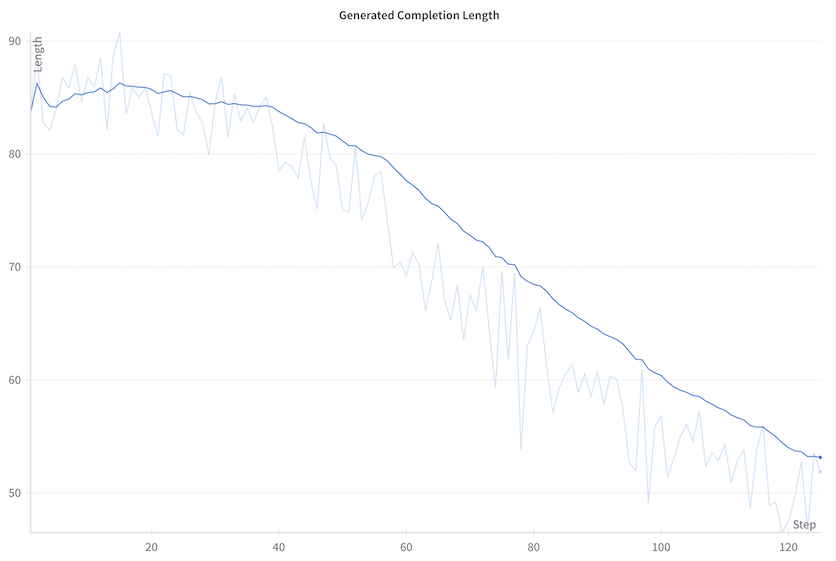

> **Generated Completion Length** = Üretilen tamamlama uzunluğu · **Length** = Uzunluk · **Step** = Adım

Kaybın sıfırdan başlayıp eğitim sırasında arttığını fark edebilirsiniz; bu sezgilere aykırı görünebilir. Bu davranış GRPO'da beklenir ve doğrudan algoritmanın matematiksel formülasyonuyla ilgilidir. GRPO'daki kayıp, KL ıraksamasıyla (orijinal politikaya göre sınır) orantılıdır. Eğitim ilerledikçe model, ödül fonksiyonuyla daha iyi eşleşen metin üretmeyi öğrenir ve bu da başlangıç politikasından daha fazla uzaklaşmasına neden olur. Bu artan ıraksama, yükselen kayıp değerine yansır; bu da aslında modelin ödül fonksiyonu için optimize olmaya başarıyla uyum sağladığını gösterir.

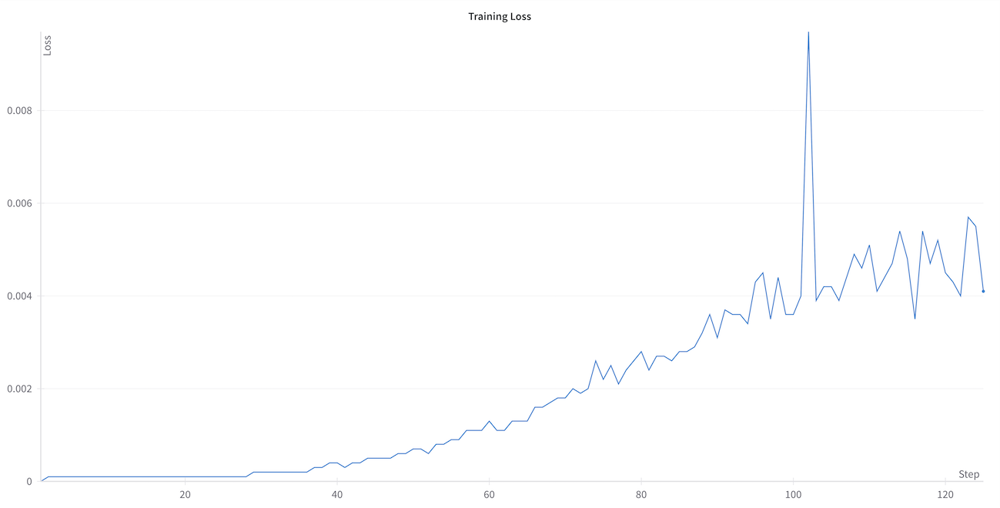

> **Training Loss** = Eğitim kaybı · **Loss** = Kayıp · **Step** = Adım

## Modeli kaydedin ve yayımlayın

Modeli toplulukla paylaşalım!

```python
merged_model = trainer.model.merge_and_unload()
merged_model.push_to_hub(
    "SmolGRPO-135M", private=False, tags=["GRPO", "Reasoning-Course"]
)
```

## Metin üretin

🎉 GRPO ile bir modele başarıyla ince ayar yaptınız! Şimdi modelle biraz metin üretelim.

Önce gerçekten uzun bir belge tanımlayacağız!

```python
prompt = """
# A long document about the Cat

The cat (Felis catus), also referred to as the domestic cat or house cat, is a small 
domesticated carnivorous mammal. It is the only domesticated species of the family Felidae.
Advances in archaeology and genetics have shown that the domestication of the cat occurred
in the Near East around 7500 BC. It is commonly kept as a pet and farm cat, but also ranges
freely as a feral cat avoiding human contact. It is valued by humans for companionship and
its ability to kill vermin. Its retractable claws are adapted to killing small prey species
such as mice and rats. It has a strong, flexible body, quick reflexes, and sharp teeth,
and its night vision and sense of smell are well developed. It is a social species,
but a solitary hunter and a crepuscular predator. Cat communication includes
vocalizations—including meowing, purring, trilling, hissing, growling, and grunting—as
well as body language. It can hear sounds too faint or too high in frequency for human ears,
such as those made by small mammals. It secretes and perceives pheromones.
"""

messages = [
    {"role": "user", "content": prompt},
]
```

> *Kedi Hakkında Uzun Bir Belge.* Kedi (Felis catus), evcil kedi veya ev kedisi olarak da anılır, küçük, evcilleştirilmiş, etçil bir memelidir. Felidae ailesinin evcilleştirilmiş tek türüdür. Arkeoloji ve genetikteki ilerlemeler, kedinin evcilleştirilmesinin MÖ 7500 civarında Yakın Doğu'da gerçekleştiğini göstermiştir. Genellikle evcil hayvan ve çiftlik kedisi olarak beslenir, ancak insan temasından kaçınan yabani bir kedi olarak da serbestçe dolaşır. İnsanlar tarafından arkadaşlığı ve haşereleri öldürme yeteneği nedeniyle değer görür. Geri çekilebilir pençeleri, fare ve sıçan gibi küçük av türlerini öldürmeye uyarlanmıştır. Güçlü, esnek bir vücudu, hızlı refleksleri ve keskin dişleri vardır; gece görüşü ve koku alma duyusu iyi gelişmiştir. Sosyal bir türdür, ancak yalnız avlanır ve alacakaranlıkta aktif bir yırtıcıdır. Kedi iletişimi; miyavlama, mırlama, trilleme, tıslama, hırlama ve homurdanma gibi seslendirmelerin yanı sıra beden dilini de içerir. Küçük memelilerin çıkardığı gibi insan kulağı için fazla zayıf veya frekansı fazla yüksek sesleri duyabilir. Feromon salgılar ve algılar.

Şimdi modelle metin üretebiliriz.

```python
# Metin üret
from transformers import pipeline

generator = pipeline("text-generation", model="SmolGRPO-135M")

## Ya da daha önce tanımladığımız model ve tokenizer'ı kullanın
# generator = pipeline("text-generation", model=model, tokenizer=tokenizer)

generate_kwargs = {
    "max_new_tokens": 256,
    "do_sample": True,
    "temperature": 0.5,
    "min_p": 0.1,
}

generated_text = generator(messages, generate_kwargs=generate_kwargs)

print(generated_text)
```

# Sonuç

Bu bölümde GRPO ile bir modele nasıl ince ayar yapılacağını gördük. Ayrıca eğitim sonuçlarının nasıl yorumlanacağını ve modelle nasıl metin üretileceğini de gördük.

---

[](https://colab.research.google.com/github/unslothai/notebooks/blob/main/nb/HuggingFace%20Course-Gemma3_(1B)-GRPO.ipynb)

# Pratik Alıştırma: Unsloth ile GRPO

Bu alıştırmada, bir modelin akıl yürütme yeteneklerini geliştirmek için Unsloth kullanarak GRPO (Grup Göreli Politika Optimizasyonu) ile bir modele ince ayar yapacaksınız. GRPO'yu [Bölüm 3](https://huggingface.co/learn/llm-course/chapter3/3)'te ele almıştık.

Unsloth, LLM ince ayarını hızlandıran ve modelleri daha hızlı ve daha az hesaplama kaynağıyla eğitmeyi mümkün kılan bir kütüphanedir. Unsloth, TRL'ye takılarak (plug-in) çalışır; bu yüzden önceki kısımlarda öğrendiklerimizin üzerine inşa edip bunları Unsloth'a özgü ayrıntılara uyarlayacağız.

> 💡 **İpucu:** Bu alıştırma ücretsiz bir Google Colab T4 GPU'sunda çalıştırılabilir. En iyi deneyim için yukarıda bağlantısı verilen not defterini takip edin ve kendiniz deneyin.

## Bağımlılıkları yükleyin

Önce gerekli kütüphaneleri yükleyelim. Hızlandırılmış ince ayar için Unsloth'a, hızlı çıkarım (inference) için de vLLM'e ihtiyacımız olacak.

```bash
pip install unsloth vllm
pip install --upgrade pillow
```

## Unsloth'u kurmak

Unsloth, transformers'ı Unsloth optimizasyonlarıyla bütünleştiren bir sınıf (`FastLanguageModel`) sağlar. Onu içe aktaralım:

```python
from unsloth import FastLanguageModel
```

Şimdi Google'ın Gemma 3 1B Instruct modelini yükleyip ince ayar için yapılandıralım:

```python
from unsloth import FastLanguageModel
import torch

max_seq_length = 1024  # Daha uzun akıl yürütme izleri için artırılabilir
lora_rank = 32  # Daha büyük rank = daha akıllı, ama daha yavaş

model, tokenizer = FastLanguageModel.from_pretrained(
    model_name="google/gemma-3-1b-it",
    max_seq_length=max_seq_length,
    load_in_4bit=True,  # 16 bit LoRA için False
    fast_inference=True,  # vLLM hızlı çıkarımı etkinleştir
    max_lora_rank=lora_rank,
    gpu_memory_utilization=0.6,  # Bellek yetmezse azaltın
)

model = FastLanguageModel.get_peft_model(
    model,
    r=lora_rank,  # 0'dan büyük herhangi bir sayı seçin! Önerilen: 8, 16, 32, 64, 128
    target_modules=[
        "q_proj",
        "k_proj",
        "v_proj",
        "o_proj",
        "gate_proj",
        "up_proj",
        "down_proj",
    ],  # Bellek yetmezse QKVO'yu çıkarın
    lora_alpha=lora_rank,
    use_gradient_checkpointing="unsloth",  # Uzun bağlamlı ince ayarı etkinleştir
    random_state=3407,
)
```

Bu kod, bellekten tasarruf etmek için modeli 4 bit nicemleme (quantization) ile yükler ve verimli ince ayar için LoRA'yı (Low-Rank Adaptation, Düşük Ranklı Uyarlama) uygular. `target_modules` parametresi modelin hangi katmanlarına ince ayar yapılacağını belirtir, `use_gradient_checkpointing` ise daha uzun bağlamlarla eğitimi mümkün kılar.

> 💡 **İpucu:** Bu bölümde LoRA'nın ayrıntılarına girmeyeceğiz, ancak [Bölüm 11](https://huggingface.co/learn/llm-course/chapter11/3)'de daha fazlasını öğrenebilirsiniz.

## Veri Hazırlığı

Bu alıştırmada, ilkokul düzeyinde matematik problemleri içeren GSM8K veri kümesini kullanacağız. Veriyi, modeli bir cevap vermeden önce akıl yürütmesini göstermeye teşvik edecek şekilde biçimlendireceğiz.

Önce istemlerin ve cevapların formatını tanımlayacağız:

```python
# Modele belirli bir format kullanmasını söyleyen sistem istemini tanımla
SYSTEM_PROMPT = """
Respond in the following format:
<reasoning>
...
</reasoning>
<answer>
...
</answer>
"""

XML_COT_FORMAT = """\
<reasoning>
{reasoning}
</reasoning>
<answer>
{answer}
</answer>
"""
```

(Sistem isteminin anlamı: "Aşağıdaki formatta yanıt ver: `<reasoning>` akıl yürütme `</reasoning>` `<answer>` cevap `</answer>`")

Şimdi veri kümesini hazırlayalım:

```python
import re
from datasets import load_dataset, Dataset

# Farklı formatlardan cevapları çıkarmak için yardımcı fonksiyonlar
def extract_xml_answer(text: str) -> str:
    answer = text.split("<answer>")[-1]
    answer = answer.split("</answer>")[0]
    return answer.strip()

def extract_hash_answer(text: str) -> str | None:
    if "####" not in text:
        return None
    return text.split("####")[1].strip()

# GSM8K veri kümesini hazırlayan fonksiyon
def get_gsm8k_questions(split="train") -> Dataset:
    data = load_dataset("openai/gsm8k", "main")[split]
    data = data.map(
        lambda x: {
            "prompt": [
                {"role": "system", "content": SYSTEM_PROMPT},
                {"role": "user", "content": x["question"]},
            ],
            "answer": extract_hash_answer(x["answer"]),
        }
    )
    return data

dataset = get_gsm8k_questions()
```

Veri kümesi, cevap veri kümesinden çıkarılarak ve bir dize (string) olarak biçimlendirilerek hazırlanır.

## Ödül Fonksiyonlarını Tanımlamak

[Önceki bir sayfada](https://huggingface.co/learn/llm-course/chapter12/4) tartıştığımız gibi, GRPO, modelin öğrenmesini uzunluk ve biçimlendirme gibi doğrulanabilir ölçütlere göre yönlendirmek için ödül fonksiyonlarını kullanabilir.

Bu alıştırmada, iyi akıl yürütmenin farklı yönlerini teşvik eden birkaç ödül fonksiyonu tanımlayacağız. Örneğin, modeli tam sayı (integer) bir cevap verdiği ve katı formata uyduğu için ödüllendireceğiz.

```python
# Cevabın doğru olup olmadığını kontrol eden ödül fonksiyonu
def correctness_reward_func(prompts, completions, answer, **kwargs) -> list[float]:
    responses = [completion[0]["content"] for completion in completions]
    q = prompts[0][-1]["content"]
    extracted_responses = [extract_xml_answer(r) for r in responses]
    print(
        "-" * 20,
        f"Question:\n{q}",
        f"\nAnswer:\n{answer[0]}",
        f"\nResponse:\n{responses[0]}",
        f"\nExtracted:\n{extracted_responses[0]}",
    )
    return [2.0 if r == a else 0.0 for r, a in zip(extracted_responses, answer)]

# Cevabın bir tam sayı olup olmadığını kontrol eden ödül fonksiyonu
def int_reward_func(completions, **kwargs) -> list[float]:
    responses = [completion[0]["content"] for completion in completions]
    extracted_responses = [extract_xml_answer(r) for r in responses]
    return [0.5 if r.isdigit() else 0.0 for r in extracted_responses]

# Tamamlamanın katı formata uyup uymadığını kontrol eden ödül fonksiyonu
def strict_format_reward_func(completions, **kwargs) -> list[float]:
    pattern = r"^<reasoning>\n.*?\n</reasoning>\n<answer>\n.*?\n</answer>\n$"
    responses = [completion[0]["content"] for completion in completions]
    matches = [re.match(pattern, r) for r in responses]
    return [0.5 if match else 0.0 for match in matches]

# Tamamlamanın daha esnek bir formata uyup uymadığını kontrol eden ödül fonksiyonu
def soft_format_reward_func(completions, **kwargs) -> list[float]:
    pattern = r"<reasoning>.*?</reasoning>\s*<answer>.*?</answer>"
    responses = [completion[0]["content"] for completion in completions]
    matches = [re.match(pattern, r) for r in responses]
    return [0.5 if match else 0.0 for match in matches]

# XML etiketlerini sayan ve fazladan içeriği cezalandıran ödül fonksiyonu
def count_xml(text) -> float:
    count = 0.0
    if text.count("<reasoning>\n") == 1:
        count += 0.125
    if text.count("\n</reasoning>\n") == 1:
        count += 0.125
    if text.count("\n<answer>\n") == 1:
        count += 0.125
        count -= len(text.split("\n</answer>\n")[-1]) * 0.001
    if text.count("\n</answer>") == 1:
        count += 0.125
        count -= (len(text.split("\n</answer>")[-1]) - 1) * 0.001
    return count

def xmlcount_reward_func(completions, **kwargs) -> list[float]:
    contents = [completion[0]["content"] for completion in completions]
    return [count_xml(c) for c in contents]
```

Bu ödül fonksiyonları farklı amaçlara hizmet eder:

| Ödül Fonksiyonu | Amaç |
|-----------------|------|
| `correctness_reward_func` | Modelin cevabı doğru cevapla eşleştiğinde modeli ödüllendirir |
| `int_reward_func` | Modeli sayısal bir cevap verdiği için ödüllendirir |
| `strict_format_reward_func` ve `soft_format_reward_func` | Modeli belirtilen formata uyduğu için ödüllendirir |
| `xmlcount_reward_func` | Doğru XML etiketi kullanımını ödüllendirir ve kapanış etiketlerinden sonraki fazladan içeriği cezalandırır |

## GRPO ile Eğitim

Şimdi GRPO eğiticisini modelimiz, tokenizer'ımız ve ödül fonksiyonlarımızla kuracağız. Bu kısım [önceki alıştırmadaki](https://huggingface.co/learn/llm-course/chapter12/5) yaklaşımın aynısını izler.

```python
from trl import GRPOConfig, GRPOTrainer

max_prompt_length = 256

training_args = GRPOConfig(
    learning_rate=5e-6,
    adam_beta1=0.9,
    adam_beta2=0.99,
    weight_decay=0.1,
    warmup_ratio=0.1,
    lr_scheduler_type="cosine",
    optim="paged_adamw_8bit",
    logging_steps=1,
    per_device_train_batch_size=1,
    gradient_accumulation_steps=1,  # Daha pürüzsüz eğitim için 4'e çıkarın
    num_generations=6,  # Bellek yetmezse azaltın
    max_prompt_length=max_prompt_length,
    max_completion_length=max_seq_length - max_prompt_length,
    # num_train_epochs = 1, # Tam bir eğitim çalıştırması için 1 yapın
    max_steps=250,
    save_steps=250,
    max_grad_norm=0.1,
    report_to="none",  # Weights & Biases kullanılabilir
    output_dir="outputs",
)

trainer = GRPOTrainer(
    model=model,
    processing_class=tokenizer,
    reward_funcs=[
        xmlcount_reward_func,
        soft_format_reward_func,
        strict_format_reward_func,
        int_reward_func,
        correctness_reward_func,
    ],
    args=training_args,
    train_dataset=dataset,
)
```

`GRPOConfig` eğitim için çeşitli hiperparametreleri ayarlar:
- `use_vllm`: vLLM ile hızlı çıkarımı etkinleştirir
- `learning_rate`: Modelin ne kadar hızlı öğrendiğini kontrol eder
- `num_generations`: Her istem için üretilecek tamamlama sayısı
- `max_steps`: Gerçekleştirilecek toplam eğitim adımı sayısı

Şimdi eğitimi başlatalım:

```python
trainer.train()
```

> ⚠️ **Uyarı:** Eğitim biraz zaman alabilir. Ödüllerin hemen arttığını görmeyebilirsiniz; iyileşmeleri görmeye başlamanız 150-200 adım sürebilir. Sabırlı olun!

## Modeli Test Etmek

Eğitimden sonra modelimizin nasıl performans gösterdiğini görmek için onu test edelim. Önce LoRA ağırlıklarını kaydedeceğiz:

```python
model.save_lora("grpo_saved_lora")
```

Şimdi modeli yeni bir soruyla test edelim:

```python
from vllm import SamplingParams

text = tokenizer.apply_chat_template(
    [
        {"role": "system", "content": SYSTEM_PROMPT},
        {"role": "user", "content": "Calculate pi."},
    ],
    tokenize=False,
    add_generation_prompt=True,
)

sampling_params = SamplingParams(
    temperature=0.8,
    top_p=0.95,
    max_tokens=1024,
)
output = (
    model.fast_generate(
        text,
        sampling_params=sampling_params,
        lora_request=model.load_lora("grpo_saved_lora"),
    )[0]
    .outputs[0]
    .text
)

print(output)
```

("Calculate pi." = "Pi sayısını hesapla.")

Modelin artık belirtilen formata uyduğunu, yani bir cevap vermeden önce akıl yürütmesini gösterdiğini görmelisiniz.

## Modeli Kaydetmek

Unsloth, ince ayar yapılmış modelinizi kaydetmek için birkaç seçenek sunar, ancak biz en yaygın olanına odaklanacağız.

```python
# 16 bit hassasiyetle kaydet
model.save_pretrained_merged("model", tokenizer, save_method="merged_16bit")
```

## Hugging Face Hub'a Göndermek

Modeli `push_to_hub_merged` metodunu kullanarak Hugging Face Hub'a göndereceğiz. Bu metot, modeli birden fazla nicemleme formatında göndermemize olanak tanır.

```python
# Hugging Face Hub'a gönder (bir token gerektirir)
model.push_to_hub_merged(
    "your-username/model-name", tokenizer, save_method="merged_16bit", token="your-token"
)
```

Unsloth, llama.cpp ile kullanım için GGUF formatında kaydetmeyi de destekler:

```python
model.push_to_hub_gguf(
    "your-username/model-name",
    tokenizer,
    quantization_method=["q4_k_m", "q8_0", "q5_k_m"],
    token="your-token",
)
```

GGUF dosyaları llama.cpp ile ya da Jan veya Open WebUI gibi arayüz tabanlı sistemlerle kullanılabilir.

## Sonuç

Bu alıştırmada şunları öğrendiniz:
1. Hızlandırılmış ince ayar için Unsloth'u kurmak
2. GRPO eğitimi için veri hazırlamak
3. Modelin öğrenmesine rehberlik edecek özel ödül fonksiyonları tanımlamak
4. GRPO kullanarak bir model eğitmek
5. İnce ayar yapılmış modeli test etmek
6. Modeli çeşitli formatlarda kaydetmek

GRPO, dil modellerini belirli davranışlarla hizalamak için güçlü bir tekniktir ve Unsloth onu sınırlı donanımda bile erişilebilir kılar. Birden fazla ödül fonksiyonunu birleştirerek, modeli belirli bir formata uymaya yönlendirirken akıl yürütme yeteneklerini de geliştirebilirsiniz.

Daha fazla bilgi ve kaynak için şunlara göz atın:
- [Unsloth Dokümantasyonu](https://docs.unsloth.ai/)
- [Unsloth Discord](https://discord.gg/unsloth)
- [Unsloth GitHub](https://github.com/unslothai/unsloth)

---

# Çok yakında... (Coming soon...)

Bu bölüm şu anda canlı bir grup (cohort) olarak yürütülüyor! Şimdiye kadarki materyali bitirdiyseniz, sizi bekleyenler şunlar:

## Kurs Takvimi

| Tarih | Ünite |
|-------|-------|
| ~~7 Mart 2025 civarı~~ | ~~Kodsuz Sınav ve Sertifika~~ |
| ~~14 Mart 2025 civarı~~ | ~~Bir Sonraki Pratik Alıştırma~~ |
| 21 Mart 2025 | Etkileşimli kod incelemesi (code review) |
| Nisan 2025 | Akıl yürütme modelleri inşa etmeye dair daha fazla yazılı materyal |
| Nisan 2025 | Open R1 inşasına dair canlı oturumlar |
| Nisan 2025 | Kodlu Sınav ve Sertifika |

## Güncel Kalmak

Kursu takip etmek istiyorsanız [The Reasoning Course](https://huggingface.co/reasoning-course)'u takip edin ve [Discord topluluğuna](https://discord.gg/F3vZujJH) katılın!

