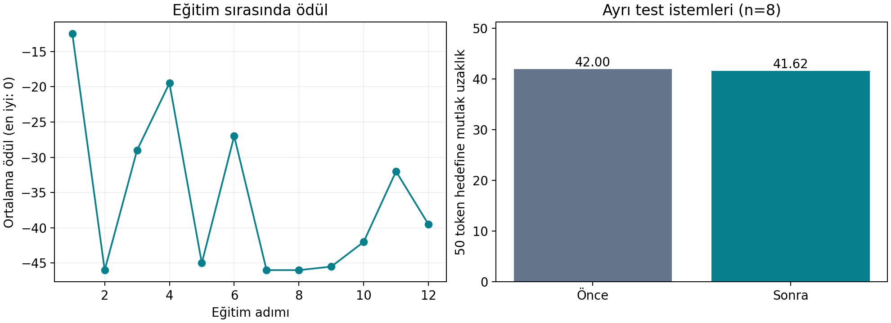

# GRPO uygulaması — gerçek çalıştırma sonuçları

Hugging Face LLM Course 12.5 uygulaması yerel bilgisayarda çalıştırıldı.

- Model: **HuggingFaceTB/SmolLM2-135M-Instruct**
- Eğitim yöntemi: **GRPO + LoRA**, yalnızca uzunluk ödülü
- Aygıt: **CPU**
- Eğitim: **12 adım**, 32 örneklik eğitim havuzu
- Test: Eğitimden ayrılmış **8 istem**
- Hedef: **50 token**; ödül = −|token sayısı − 50|
- Her istem için üretim: **2 yanıt**
- Eğitilebilir parametre: **4,884,480 / 139,399,488**
- Eğitim süresi: **2.41 dakika** (indirme/kurulum hariç)

## Önce / sonra

| Ölçüt | Eğitim öncesi | Eğitim sonrası |
|---|---:|---:|
| Ortalama çıktı uzunluğu (token) | 92.00 | 91.62 |
| Hedeften ortalama mutlak uzaklık | 42.00 | 41.62 |
| Ortalama ödül | -42.00 | -41.62 |
| 45–55 token aralığındaki çıktı oranı | 0.0% | 0.0% |
| 96 yeni token sınırına ulaşan çıktı oranı | 87.5% | 87.5% |

Ortalama mutlak uzaklıktaki azalma: **%0.89**. Negatif değer kötüleşme anlamına gelir.

Bu kısa denemede uzunluk hedefine ortalama uzaklık azaldı. Bu küçük bir eğitim denemesidir. Sadece uzunluk kontrolünü ölçer; özet doğruluğu, dil kalitesi veya akıl yürütme becerisi için başarı iddiası taşımaz.

## Her test isteminin sonucu

| İstem | Önce token | Sonra token | Önce mutlak hata | Sonra mutlak hata |
|---|---:|---:|---:|---:|
| 1 | 96 | 96 | 46 | 46 |
| 2 | 96 | 96 | 46 | 46 |
| 3 | 65 | 62 | 15 | 12 |
| 4 | 96 | 96 | 46 | 46 |
| 5 | 96 | 96 | 46 | 46 |
| 6 | 96 | 96 | 46 | 46 |
| 7 | 95 | 95 | 45 | 45 |
| 8 | 96 | 96 | 46 | 46 |

## İnceleme dosyaları

- sonuclar/once.json ve sonuclar/sonra.json: aynı istemlerin ham yanıtları
- sonuclar/ozet.json: çalışma ayarları, sürümler ve ölçümler
- sonuclar/egitim_gunlugu.jsonl: her adımın gerçek eğitim kaydı
- sonuclar/veri_ayrimi.json: eğitim ve test istemlerinin ayrımı

## Kaynaktan yapılan uyarlamalar

SmolLM/SmolLM2 ad karışıklığı giderildi ve SmolLM2-135M-Instruct seçildi.
Karakter sayan ödül yerine tokenizer ile gerçek token sayımı kullanıldı.
Windows'ta FlashAttention, bitsandbytes ve vLLM gerektirmeyen ayarlar kullanıldı.
W&B ve Hub yüklemesi kapalı tutuldu.
Aynı test istemleri ve örnekleme tohumlarıyla önce/sonra ölçüm yapıldı.

Kaynaklar: [Ders 12.5](https://huggingface.co/learn/llm-course/chapter12/5),
[TRL 0.16.1 GRPO](https://huggingface.co/docs/trl/v0.16.1/grpo_trainer),
[Model](https://huggingface.co/HuggingFaceTB/SmolLM2-135M-Instruct).

## Çalıştırma ve kayıt kontrolü

- Gerçek eğitimde 12 optimizasyon adımı tamamlandı.
- Eğitim/test istemleri arasında kesişim olmadığı ve JSON ölçümlerinin ham yanıtlardan doğru hesaplandığı doğrulandı.
- 3/12 adımda grup içi ödül standart sapması sıfırdı; bu gruplar avantajdan öğrenme sinyali üretmedi.
- 8 test isteminin hiçbirinde çıktı 45–55 token aralığına gelmedi. Bu kısa eğitim 50 token hedefini öğretmeye yetmedi.
- LoRA adaptörü diskten yeniden yüklendi ve yeni bir istem için 45 tokenlık bir çıktı üretildi. Bu ayrı kullanım kontrolü, yukarıdaki bağımsız test sonuçlarına dahil edilmedi.
- Eğitim CPU üzerinde gerçekleştirildi. RTX 4050 mevcut olsa da GPU destekli PyTorch indirmesi tamamlanamadığından GPU eğitimi yapılmadı.
- Colab defteri oluşturuldu ve kod hücrelerinin sözdizimi denetlendi; Colab'da ayrıca çalıştırılmadı.
